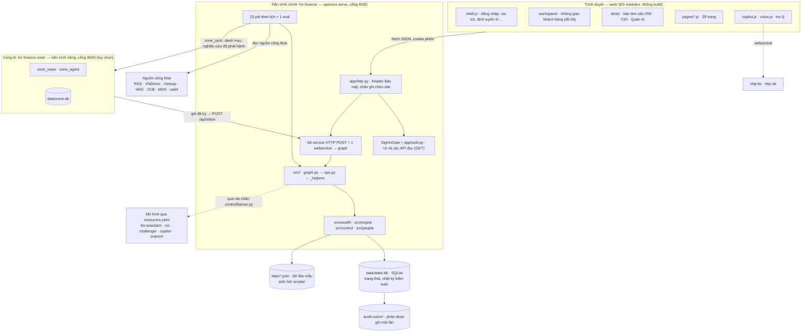
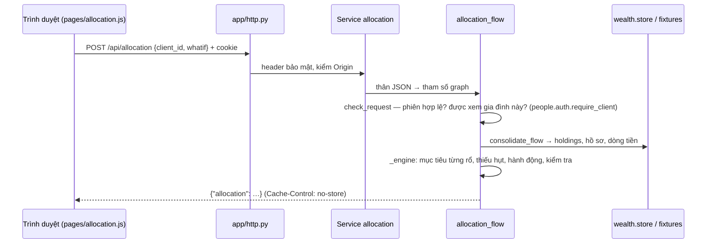
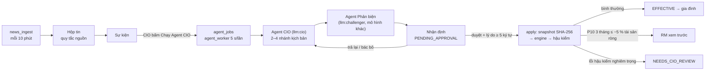
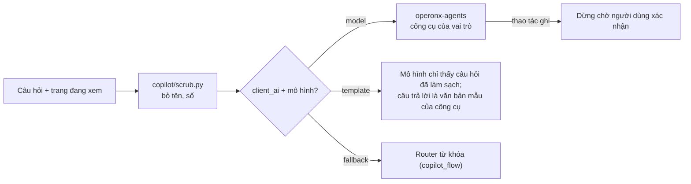

# Kiến trúc OneWealth (Mr. Finance)

*Cập nhật 2026-10-29. Mã nguồn là nguồn sự thật: [`app/main.py`](../app/main.py) là bản đồ mọi service và job,
[`AGENTS.md`](../AGENTS.md) là quy tắc viết mã. Tài liệu chi tiết (tiếng Anh) nằm trong
[`docs/brd/architecture/`](brd/architecture/), lý do của từng lựa chọn nằm trong [`docs/brd/decisions/`](brd/decisions/).*

## 1. Sản phẩm làm gì

OneWealth gom mọi tài sản của một gia đình khách hàng — sản phẩm của Techcombank, tài khoản ở ngân hàng và công ty
chứng khoán khác, những gì khách tự khai — thành **một bức tranh**, rồi cho biết **điều gì đang tác động** tới bức
tranh ấy: chính sách, thị trường, hạ tầng, sự kiện đời sống. Bốn vai trò dùng sản phẩm:

| Vai trò | Làm gì |
|---|---|
| **Khách hàng** | Xem tài sản, dòng tiền, mục tiêu, phân bổ 3 rổ, cảnh báo, kịch bản; khai báo và tải sao kê |
| **RM** | Theo dõi các gia đình mình phụ trách, xem trước tác động lớn, đề xuất và gửi hành động |
| **CIO** | Duyệt nhận định thị trường do Agent CIO soạn, duyệt phân bổ, bằng chứng, bài viết, nghiên cứu |
| **Quản trị** | Vận hành: nguồn tin, dữ liệu thị trường, lịch chạy, cấu hình, tài khoản |

Nguyên tắc xuyên suốt: **AI soạn kịch bản — máy tính tính con số — con người duyệt trước khi tới gia đình.**

## 2. Bức tranh tổng thể



| Lớp | Ở đâu | Quy tắc |
|---|---|---|
| Trình bày | `web/` | Chỉ hiển thị điều server đã quyết; không có bước build, mỗi trang là một module |
| Service | `app/main.py` (`APP`), `app/web.py` (đọc), `app/http.py` (middleware) | Một service chạy đúng một graph: thân JSON → tham số graph, đầu ra → câu trả lời |
| Tính năng | `src/<tính năng>/graph.py` → `ops.py` → `_helpers.py` | `graph.py` chỉ nối dây, không có logic hay `if`; không tính năng nào import graph của tính năng khác (ngoại lệ duy nhất: `consolidate_flow`) |
| Miền dùng chung | `src/wealth`, `src/engine`, `src/control`, `src/people` | Không có graph; `engine` thuần (không I/O, không AI) |
| AI | `src/views`, `src/evidence`, `src/policy`, `src/assistant`, `src/copilot`, `src/statements`, `src/declare` | Mô hình chỉ lấy theo khóa trong `resources.yaml`; mọi bước AI có đường quy tắc dự phòng |
| Dữ liệu | `data/*.json` (sinh bởi `scripts/`), `data/state.db` | Sửa script, không sửa JSON |

## 3. Nền tảng: operonx

Toàn bộ backend dựng trên [operonx](https://pypi.org/project/operonx/) (1.30), operonx-agents (0.3) và operonx-kb
(0.2), Python ≥ 3.11, quản lý bằng `uv`. Bậc thang khái niệm:

```text
op (@op, ops.py)  ─►  graph (@graph, graph.py, nối bằng >>)  ─►  Service (http/websocket/asgi) hoặc Job (schedule)
                                                              ─►  Application APP trong app/main.py
```

- **Chữ ký graph là request.** `POST /api/allocation {client_id, method, whatif}` điền tham số
  `allocation_flow(client_id, …, whatif=None)` theo tên; trường lạ hay thiếu trường bắt buộc → `400` trước khi chạy.
- **Lỗi có mã HTTP.** `control/errors.py`: `BadRequest` (400), `Conflict` (409); rào chắn AI trả 403. Các lỗi này mang thông điệp
  tiếng Việt tới người dùng; lỗi khác trả `500` kèm trace id.
- **Nhánh** bằng `if_(cond, a).else_(b)` trong chuỗi `>>`; không có `@graph` lồng trong hàm.
- **Truy vết**: mỗi lần chạy ghi vào `.operonx/runs` (xem bằng `uv run operonx studio`), trừ các service đọc và trợ lý
  được tắt trong `operonx.toml` — vì nhanh hơn, và vì không chép lời người dùng ra đĩa.

## 4. Cấu trúc thư mục

```text
app/        main.py (APP: service, job, eval) · web.py (UI + GET) · http.py (middleware) · zone.py (APP vùng AI)
src/        một thư mục một tính năng (bảng §5)
web/        index.html · shell.js · core/ (core.js, i18n.js, tokens.css, lang/en.js) · pages/ · desk/ · workspace/
            charts/ · copilot.js · voice.js
data/       clients/ · factor_model.json · factors.json · evidence.json · market.json · news_config.json …
            state.db (trạng thái) · audit-worm/ (phân đoạn kiểm toán)
scripts/    make_fixtures.py, make_factors.py, make_evidence.py… (sinh data/) · set_password.py · rotate_keys.py
tests/      ~90 tệp pytest (offline) · tests/ui/ Playwright
docs/       brd/ (đặc tả sống: yêu cầu → tính năng → màn hình → kiến trúc → kiểm thử) · huong-dan/ (hướng dẫn dùng)
resources.yaml · operonx.toml · operonx.zone.toml · .env.example
```

## 5. Các nhóm tính năng (`src/`)

| Nhóm | Thư mục | Vai trò |
|---|---|---|
| **Bức tranh tài sản** | `consolidate` | Graph con mọi bức tranh bắt đầu từ: gom holdings từ ba tầng nguồn, gắn nhãn tin cậy |
| | `dashboard`, `overview`, `flows`, `timeline`, `feed` | Tổng quan, dòng tiền theo tháng, lịch sử một nút đồ thị, “điều quan trọng lúc này” |
| | `statements`, `declare` | Đọc sao kê (PDF/Excel/CSV, AI hoặc quy tắc), khai báo qua chat |
| **Kế hoạch** | `risk` | Bài test khẩu vị rủi ro thích ứng: tolerance × capacity → persona |
| | `allocation` | Phân bổ 3 rổ Thanh khoản · Di sản · Tăng trưởng (phương pháp A/B/C), what-if, tilt của CIO, hàng duyệt |
| | `scenarios`, `procedural` | Sự kiện đời sống, stress test, mục tiêu và nhánh mục tiêu |
| | `impact` | Chính sách, vĩ mô, hạ tầng: tác động = phơi nhiễm × độ nhạy × xác suất |
| **Tin → nhận định → gia đình** | `news` | Thu tin RSS trong danh sách trắng, quy tắc nguồn công khai, tin khẩn |
| | `events` | Gom tin thành sự kiện |
| | `views` | Agent CIO + Agent Phản biện, hàng đợi agent, kiểm tra schema, CIO duyệt/trả/bác (`decide.py`) |
| | `engine` | Động cơ kịch bản thuần: mô hình 15 yếu tố → dải VND P5…P90 ở 3 kỳ hạn |
| | `apply` | Lần áp dụng: snapshot băm → engine cho mọi gia đình → hậu kiểm → xếp hạng, cờ RM xem trước |
| | `evidence`, `research`, `policy`, `newsletter` | Khung bằng chứng, nghiên cứu cần phát hành, văn bản pháp lý, bài viết cho khách |
| | `inbox`, `zone` | Hộp nhận gói đã ký từ vùng AI; mã của chính vùng AI |
| **Đo lường** | `market`, `measure`, `trial` | Dữ liệu thị trường theo lịch, chấm dự báo, thử nghiệm hằng ngày |
| **Con người & kiểm soát** | `people` | Tài khoản, đăng nhập, phiên |
| | `control` | Vai trò, nhật ký kiểm toán chuỗi băm, WORM, rào chắn AI, mã hóa, cấu hình hai người, cảnh báo, uptime |
| | `contacts`, `review`, `desk`, `search` | Liên hệ RM, hàng duyệt RM, dữ liệu bàn làm việc, tìm kiếm |
| **Trợ lý** | `assistant`, `copilot`, `voice`, `explain` | Trợ lý nhiều bước theo vai trò, router câu hỏi, giọng nói, “Cách tính” |
| **Miền chung** | `wealth` | Fixtures, tiền, định giá, hồ sơ, kho trạng thái — không có graph |

## 6. Các luồng chính

### 6.1 Một yêu cầu đọc của khách hàng



Mọi con số do server tính; trình duyệt chỉ vẽ. Các trang đọc khác (`dashboard`, `feed`, `goals`, `alerts`…) theo
cùng mẫu.

### 6.2 Từ tin tức tới gia đình



- Agent chỉ nhận tin của sự kiện, nghiên cứu đã phát hành, danh mục và danh sách yếu tố — **không có dữ liệu khách
  hàng**. Prompt được kiểm thử để không chứa tên, tài khoản, số dư.
- Lần áp dụng tái lập được tới từng đồng: `verify` tính lại từ snapshot và so với kết quả đã lưu.
- Trạng thái lần chạy: `COMPUTING → POST_CHECKING → EFFECTIVE | NEEDS_CIO_REVIEW | FAILED`, sau đó có thể
  `SUPERSEDED` hoặc `WITHDRAWN`.

### 6.3 Trợ lý (Copilot)



Trợ lý chỉ đọc qua các view chỉ-đọc theo vai trò, ghi nhớ hội thoại (gộp vào Bộ nhớ mỗi 5 phút, xóa theo hạn lúc
02:30), nhận tệp/ảnh, và nói/nghe qua websocket `/api/assistant/voice` (VAD silero + `http:stt` + `http:tts`).
Chi tiết: [`brd/architecture/assistant.md`](brd/architecture/assistant.md).

## 7. Dữ liệu và lưu trữ

| Kho | Nội dung | Ghi chú |
|---|---|---|
| `data/*.json`, `data/clients/` | Dữ liệu mẫu: khách hàng, thị trường ngày demo, mô hình yếu tố, khung bằng chứng, cấu hình tin | Chỉ đọc lúc chạy; sinh lại bằng `scripts/make_*.py` (tất định) |
| `data/state.db` (SQLite, `MF_STATE`) | Những gì người dùng thêm (holdings, khai báo, kết quả rủi ro), sự kiện, nhận định, lần áp dụng, hàng đợi agent, chuỗi thị trường, tài khoản, cấu hình theo phiên bản, `audit_log` | Mỗi bảng vài cột để lọc + bản ghi đầy đủ ở cột JSON `data`; mỗi lần ghi là một giao dịch |
| `audit-worm/` | Phân đoạn nhật ký ghi một lần, nối chuỗi | Job `audit_check` mỗi giờ |
| `data/zone.db` | Trạng thái riêng của vùng AI | Không chứa khách hàng hay nhân viên |

- **Ứng dụng không gọi nguồn ngoài lúc phục vụ request**: các job thị trường ghi vào `market_series`, trang chỉ đọc
  bảng này.
- **Chuyển sang cơ sở dữ liệu ngân hàng**: `control/pgexport.py` ánh xạ SQLite → PostgreSQL (JSON → `jsonb`, tách
  trường và bảng con) — xem [`brd/architecture/bank_migration.md`](brd/architecture/bank_migration.md).
- Mô hình miền: [`brd/architecture/domain_model.md`](brd/architecture/domain_model.md).

## 8. AI và rào chắn dữ liệu

| Khóa resource | Dùng cho | Khi chưa cấu hình |
|---|---|---|
| `llm:cio` | Agent CIO, Agent Chính sách, viết bản tin | Chạy mô phỏng (từ khóa), ghi rõ là mock |
| `llm:challenger` | Agent Phản biện — phải khác mô hình của CIO | Mô phỏng |
| `llm:copilot` | Trợ lý, tiêu đề hội thoại, bộ nhớ, router | Router từ khóa |
| `llm:assistant` | Đọc sao kê, khai báo qua chat (chế độ demo) | Đường quy tắc |
| `llm:onprem` | Hai bước trên ở chế độ `onprem` (mô hình trong ngân hàng) | Đường quy tắc |

- **`MF_AI`** = `on | off | auto` bật/tắt mọi bước AI; `auto` bật khi có `LLM_API_KEY`.
- **Cấu hình `client_ai`** (Quản trị, hai người duyệt) = `demo | onprem | off`. Ở `onprem`/`off`, mọi lời gọi mô hình
  đi qua `control/barrier.check`: gửi tới máy ngoài danh sách `onprem_hosts` mà mang định danh khách hàng thì bị chặn
  (403), ghi log và kiểm toán, không gửi gì.
- **Cấu hình chế độ agent** = `live | inbox | mock`:
  - `live` — agent chạy trong tiến trình chính, chỉ nhận đầu vào không có dữ liệu khách hàng
    ([ADR-0009](brd/decisions/ADR-0009-ai-barrier-by-graph-inputs-in-one-process.md)).
  - `inbox` — agent chạy ở **vùng AI** tách biệt ([ADR-0022](brd/decisions/ADR-0022-the-ai-zone-is-a-second-process.md)):
    vùng AI ký gói (HMAC `MF_INBOX_KEY`) gửi `POST /api/inbox`; job `inbox_import` kiểm tra rồi nhập như một lần chạy
    thật; job `zone_sync` đẩy sang vùng AI chỉ danh mục đã duyệt và nghiên cứu đã phát hành (ký `MF_ZONE_KEY`).
  - `mock` — không gọi mô hình.

## 9. Bảo mật và kiểm soát

| Cơ chế | Cách làm | Mã |
|---|---|---|
| Đăng nhập | Tài khoản riêng từng người, mật khẩu scrypt có salt; cookie HttpOnly ký HMAC-SHA256 (`MF_SESSION_SECRET`) | `people/auth.py` |
| Phân quyền | Mỗi hành động mang `by` = người đang đăng nhập; vai trò và tách nhiệm được kiểm tra ở server; dữ liệu gia đình chỉ cho gia đình đó và RM phụ trách | `control/roles.py`, `people/auth.require_client` |
| Hai người | Cấu hình, phát hành nghiên cứu, duyệt bài viết, xác nhận văn bản, tài khoản: người đề xuất không tự duyệt | `control/config.py` |
| Nhật ký kiểm toán | Append-only (trigger chặn UPDATE/DELETE), mỗi dòng băm nối dòng trước (HMAC khi có `AUDIT_HMAC_KEY`); ghi cùng giao dịch với thay đổi | `control/audit.py` |
| WORM | Phân đoạn ghi một lần, nối chuỗi, đối chiếu từng byte với DB | `control/worm.py` |
| Mã hóa lúc lưu | AES-256-GCM theo cột, khóa `MF_DATA_KEYS`, xoay khóa bằng `scripts/rotate_keys.py` | `control/crypto.py` |
| HTTP | CSP chặt, `nosniff`, không referrer, HSTS qua HTTPS, `no-store` cho `/api/`, chặn ghi từ Origin khác (403) | `app/http.py` |

Bí mật chỉ nằm trong `.env` (khai báo `${VAR}` trong `resources.yaml`, liệt kê trong `.env.example`). Cờ cho máy
phát triển: `MF_AUTH=off` hiện lại bộ chuyển vai trò, `MF_DEMO_ACCOUNTS=on` hiện danh sách tài khoản demo trên trang
đăng nhập.

## 10. Việc nền (Job)

Chạy trên đồng hồ của `operonx serve`, hoặc chạy tay bằng `uv run operonx run <tên>`.

| Nhóm | Job | Lịch |
|---|---|---|
| Tin | `news_ingest` · `news_reference` | 10 phút · 2 giờ |
| Thị trường | `market_equity` 15:45 · `market_flows` 16:00 · `market_yields` 17:30 · `market_fx`, `market_world`… mỗi giờ · `market_load`, `market_backfill` theo yêu cầu | |
| Agent | `agent_worker` (một lần chạy mỗi lúc) · `inbox_import` · `zone_sync` | vài giây · 10 phút |
| Khách hàng | `policy_sweep` — cảnh báo cho mọi khách | 07:00 |
| Trợ lý | `assistant_consolidate` · `assistant_retention` | 5 phút · 02:30 |
| Kiểm soát | `heartbeat` (uptime giờ làm việc) · `audit_check` (chuỗi + WORM) | 20 giây · mỗi giờ |
| Đo lường | `accuracy_score` · `trial_daily` · `trial_score` · `agent_eval` | hằng ngày |
| Eval | `statement_reading` | theo yêu cầu |

Danh sách đầy đủ và mô tả: `uv run operonx run --list`.

## 11. Giao diện web

- **Không bước build**: `web/index.html` nạp `shell.js`; mỗi trang là một ES module trong `pages/`, nạp động kèm
  `?v=<phiên bản>` để vượt cache; server trả `Cache-Control: no-cache`. Tab đang mở giữ module cũ tới khi tải lại.
- **Định tuyến bằng hash**: `#/<vai trò>/<trang>[/<id>]`, ví dụ `#/cio/nhan-dinh/VW-0001-v1`. Shell chỉ hiện trang
  của vai trò đã đăng nhập.
- **Khách hàng** có một không gian duy nhất (`workspace/`: đồ thị tài sản thường trực, thanh công cụ, dock) dưới bốn
  mục mang tên của ngân hàng; trang cũ mở thành sheet đè lên
  ([ADR-0035](brd/decisions/ADR-0035-the-customer-workspace-is-one-persistent-graph.md),
  [ADR-0037](brd/decisions/ADR-0037-the-clients-four-sections-carry-the-banks-names.md)).
- **Nhân viên** làm việc ở bàn của vai trò (`desk/roles.js`: CIO “Decision board”, Quản trị “Vận hành”, RM), trợ lý
  gắn sẵn ([ADR-0036](brd/decisions/ADR-0036-every-staff-role-works-at-its-own-desk.md)).
- **Ngôn ngữ**: chuỗi gốc tiếng Việt; mặc định hiển thị tiếng Anh qua sổ cụm từ `core/lang/en.js` (hỗ trợ mẫu `{0}`);
  nội dung người dùng gõ và `[data-raw]` không bị dịch.
- **Giao diện**: token màu trong `core/tokens.css`, sáng/tối; biểu đồ tự vẽ trong `charts/`.

## 12. Cấu hình và chạy

```bash
uv sync
uv run pytest                                  # bộ kiểm thử offline
uv run operonx serve                           # http://127.0.0.1:8030, cùng mọi job theo lịch
MF_DEMO_ACCOUNTS=on uv run operonx serve       # hiện tài khoản demo trên trang đăng nhập
uv run operonx studio                          # xem, chạy, truy vết từng graph

# Vùng AI (tùy chọn, chế độ inbox):
MF_STATE=data/zone.db MF_DATA=data/zone uv run operonx serve -f operonx.zone.toml   # cổng 8040
```

| Tệp | Chứa gì |
|---|---|
| `operonx.toml` | Trỏ CLI tới `app.main:APP`, cấu hình truy vết theo service |
| `operonx.zone.toml` | Trỏ tới `app.zone:APP` |
| `resources.yaml` | Mô hình, TTS/STT, VAD — theo khóa |
| `.env` | Khóa API, `MF_*`, khóa ký và mã hóa (không commit) |

Bản demo công khai phục vụ nhánh `main` qua ngrok, cổng 8030
([`brd/architecture/system_overview.md`](brd/architecture/system_overview.md) §5).

## 13. Kiểm thử

- **pytest, offline**: gọi op trực tiếp (`op(x=1)()`), chạy graph bằng `Operon` hoặc `Job`; mô hình luôn là mô hình
  giả (`operonx.agents.testing`).
- **Playwright** (`tests/ui/`): đi qua các trang thật trên server thử.
- **Kiểm tra tài liệu**: `tests/test_brd_docs.py` hỏng nếu link, ID hay test được trích dẫn trong `docs/brd/` bị lệch.
- **Eval**: `statement_reading`, `agent_eval` chấm các bước AI trên mô hình thật
  ([ADR-0034](brd/decisions/ADR-0034-readiness-by-an-eval-gate-on-real-models.md)).

## 14. Những quyết định kiến trúc chính

| ADR | Quyết định |
|---|---|
| [0002](brd/decisions/ADR-0002-implement-the-brd-on-operonx-not-the-brd-stack.md) | Dựng trên operonx, không theo stack minh họa trong BRD |
| [0009](brd/decisions/ADR-0009-ai-barrier-by-graph-inputs-in-one-process.md) | Rào chắn AI bằng đầu vào của graph, trong một tiến trình |
| [0011](brd/decisions/ADR-0011-engine-in-floats-rounded-to-the-dong.md) | Engine tính số thực, chỉ làm tròn tới đồng ở một chỗ |
| [0012](brd/decisions/ADR-0012-the-copilot-routes-and-never-reads-client-data.md) | Copilot chỉ định tuyến, không đọc dữ liệu khách |
| [0019](brd/decisions/ADR-0019-every-page-is-a-module-page.md) | Mỗi trang là một module |
| [0020](brd/decisions/ADR-0020-sign-in-with-own-accounts.md) | Đăng nhập bằng tài khoản riêng |
| [0021](brd/decisions/ADR-0021-market-data-through-scheduled-jobs.md) | Dữ liệu thị trường qua job theo lịch |
| [0022](brd/decisions/ADR-0022-the-ai-zone-is-a-second-process.md) | Vùng AI là tiến trình thứ hai |
| [0035](brd/decisions/ADR-0035-the-customer-workspace-is-one-persistent-graph.md) · [0036](brd/decisions/ADR-0036-every-staff-role-works-at-its-own-desk.md) | Không gian khách hàng một đồ thị; bàn làm việc cho từng vai trò |
| [0040](brd/decisions/ADR-0040-the-assistant-queries-role-scoped-read-only-views.md) | Trợ lý chỉ truy vấn view chỉ-đọc theo vai trò |

Danh sách đầy đủ: [`brd/decisions/README.md`](brd/decisions/README.md).

## 15. Đọc tiếp

| Tài liệu | Nội dung |
|---|---|
| [`brd/architecture/system_overview.md`](brd/architecture/system_overview.md) | Đối chiếu kiến trúc với ba lớp của BRD; logic còn nằm ở trình duyệt |
| [`brd/architecture/data_flows.md`](brd/architecture/data_flows.md) | Luồng dữ liệu, ai đọc gì |
| [`brd/architecture/api_reference.md`](brd/architecture/api_reference.md) | Tham chiếu API |
| [`brd/architecture/agent_workflows.md`](brd/architecture/agent_workflows.md) | Các agent và workflow |
| [`brd/architecture/integrations.md`](brd/architecture/integrations.md) | Tích hợp bên ngoài |
| [`huong-dan/`](huong-dan/) | Hướng dẫn sử dụng theo vai trò |
