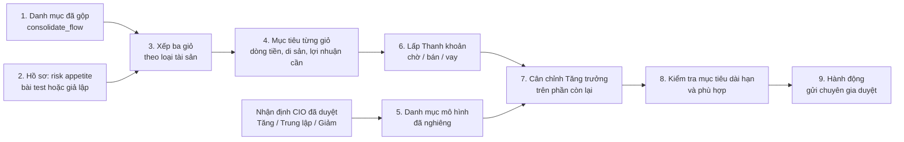

# BRD — Phân bổ tài sản theo ba giỏ (Asset allocation) trong Wealth Planning Advisor

| | |
|---|---|
| Ngày | 28/10/2026 |
| Trạng thái | **Đề xuất**, chưa triển khai |
| Người yêu cầu | Chủ sản phẩm, trong phiên làm việc 28/10/2026 ([nguồn](brd/sources/owner_requests/2026-10-28_asset_allocation.md)) |
| Mã yêu cầu | OWN-AA-01 … OWN-AA-13 ([owner_requirements](brd/requirements/owner_requirements.md#aa--asset-allocation-in-wealth-planning-advisor-2026-10-28)) |
| Tính năng | [FEAT-44](brd/features/FEAT-44-asset-allocation.md); màn hình [SCR-CL-13](brd/ux/screens/client.md#scr-cl-13--phân-bổ-tài-sản-asset-allocation) |
| Liên quan | FEAT-24 (bài test khẩu vị rủi ro), FEAT-26 (mục tiêu, kịch bản), FEAT-27 (gửi chuyên gia duyệt), FEAT-20 (gộp tài sản), [BRD tin tức là bằng chứng](NEWS_EVIDENCE_BRD.md) §11, tài liệu *Luồng end-to-end mới – Wealth Platform sau thay đổi* (28/10/2026) §3, §5 |

## 1. Bối cảnh và vấn đề

Hôm nay Wealth Planning Advisor trả lời được hai câu: **mục tiêu sống** của khách đủ hay thiếu tiền (Kế hoạch, FEAT-26), và
khách **chịu được rủi ro** đến đâu (Risk profile test, FEAT-24). Còn thiếu câu thứ ba: **cơ cấu tài sản hiện tại có hợp với
hai điều đó không, và cần làm gì** — bán gì, mua thêm gì, có nên vay không.

Tài liệu *Luồng end-to-end mới* (§3, §5) đã nêu ý tưởng ba giỏ và danh mục mô hình, nhưng:

- giỏ chỉ là cách **xếp tài sản**, chưa có **mục tiêu tiền** cho từng giỏ, nên không biết giỏ đủ hay thiếu vì sao;
- nhu cầu thanh khoản là một con số ("chi tiêu và mục tiêu đến hạn trong 3 năm"), không thấy **dòng tiền** sinh ra nó;
- vay chỉ được xem là rủi ro (LTV, lãi thả nổi), không là **một cách** để lấp giỏ thiếu;
- thứ tự tính sai: cân chỉnh giỏ Tăng trưởng trên quy mô cũ rồi mới rút tiền sang giỏ Thanh khoản (ví dụ §10 ra 10 tỷ cổ
  phiếu cần bán thay vì khoảng 13 tỷ).

BRD này thêm tab **Asset allocation** vào Wealth Planning Advisor, nối bốn đầu vào — risk appetite, danh mục hiện tại,
mục tiêu ba giỏ, nhận định CIO đã duyệt — thành một danh sách hành động có số tiền và lý do.

## 2. Nguyên tắc

| # | Nguyên tắc |
|---|---|
| AA-N1 | **Mọi con số tính từ dữ liệu đã biết** (số dư, dòng tiền, hợp đồng vay, khoản chi có ngày) hoặc từ **giả định có nhãn** do CIO hay khách đặt (lạm phát, lợi nhuận kỳ vọng từng loại tài sản, tuổi nghỉ hưu). Không dự báo giá ([BRD tin tức](NEWS_EVIDENCE_BRD.md) N1). |
| AA-N2 | **Thanh khoản trước, Tăng trưởng sau.** Giỏ Thanh khoản được lấp trước; giỏ Tăng trưởng cân chỉnh trên phần còn lại. |
| AA-N3 | **Không đề xuất bán giỏ Di sản.** Thiếu ở giỏ Di sản được lấp bằng cách khác (bảo hiểm có người thụ hưởng, tiết kiệm). |
| AA-N4 | **Không tự nâng mức rủi ro.** Khi mục tiêu cần lợi nhuận cao hơn mức rủi ro cho phép, hệ thống nêu lựa chọn (tiết kiệm thêm, lùi mốc, làm lại bài test), không đổi mức. |
| AA-N5 | **Gợi ý ở cấp loại tài sản**, không chỉ định mã, không giá mục tiêu, không cụm từ cấm FR-604 ("chắc chắn", "cam kết lợi nhuận"…). |
| AA-N6 | **Tính bằng công thức, không bằng AI.** Cùng đầu vào cho cùng kết quả. |
| AA-N7 | Gợi ý tới khách chỉ sau khi **chuyên gia duyệt** (luồng FEAT-27 hiện có); ai duyệt ở bản ngân hàng là câu hỏi mở (Q-29). |

## 3. Phạm vi

**Trong phạm vi:** tab Asset allocation (Wealth Planning Advisor) cho khách và cho RM (staff view); xếp ba giỏ; mục tiêu
từng giỏ; bảng dòng tiền 3 năm; danh mục mô hình theo 5 mức rủi ro và mức nghiêng do CIO chọn; thứ tự lấp giỏ; so sánh
chờ / bán / vay; xếp bậc thang giỏ Thanh khoản; cân chỉnh giỏ Tăng trưởng; kiểm tra phù hợp cơ bản; danh sách hành động
gửi chuyên gia duyệt; risk appetite giả lập cho khách mẫu chưa làm bài test.

**Ngoài phạm vi:** chọn mã cổ phiếu, quỹ, trái phiếu cụ thể; tự đặt lệnh; Black–Litterman (P2, theo BRD tin tức §11); CIO
duyệt từng gợi ý (P2, Q-29); dữ liệu AML, PEP; định giá lại bất động sản.

## 4. Luồng xử lý



| Bước | Làm gì | Nguồn dữ liệu | Đầu ra |
|---|---|---|---|
| 1 | Lấy tài sản và khoản vay của khách (cá nhân hoặc gia đình) | `consolidate_flow` (FEAT-20) | Danh sách tài sản, khoản vay |
| 2 | Lấy mức rủi ro 1–5 và ngưỡng sụt giảm | Kết quả bài test (FEAT-24); chưa có thì hồ sơ giả lập, ghi "Giả lập" | Mức rủi ro, nguồn, ngày |
| 3 | Xếp từng tài sản vào một giỏ (mục 5) | Mã loại tài sản (`wealth/labels.py`) | Ba giỏ |
| 4 | Tính mục tiêu và đủ/thiếu từng giỏ (mục 6) | Thu nhập, chi tiêu, khoản chi có ngày, người phụ thuộc, mong muốn để lại, tuổi nghỉ hưu | Cần / có / thiếu |
| 5 | Lấy danh mục mô hình của mức rủi ro, cộng mức nghiêng CIO đã duyệt (mục 7) | Bảng mô hình; quyết định nhận định (FEAT-06) | Tỷ trọng mục tiêu giỏ Tăng trưởng |
| 6 | Lấp giỏ Thanh khoản: so sánh ba cách, chọn, xếp bậc thang (mục 8.1–8.3) | Bước 4, 5; lãi vay; thuế giao dịch | Số tiền chuyển, nguồn tiền |
| 7 | Cân chỉnh giỏ Tăng trưởng về mô hình trên quy mô còn lại (mục 8.4) | Bước 5, 6 | Mua / bán từng loại |
| 8 | Lợi nhuận cần so với lợi nhuận kỳ vọng; kịch bản xấu trước/sau; kiểm tra phù hợp (mục 9) | Bước 4–7 | PASS / WARN / BLOCK, lựa chọn |
| 9 | Ghép thành danh sách hành động, mỗi dòng có lý do và nhận định liên quan | Bước 6–8 | Hành động, gửi chuyên gia |

## 5. Ba giỏ: tài sản nào vào giỏ nào

| Giỏ | Mã loại tài sản | Ghi chú |
|---|---|---|
| **Thanh khoản** | `cash`, `deposit` | Chỉ đến mức mục tiêu; phần dư chuyển sang giỏ Tăng trưởng thành "tiền chờ đầu tư" |
| **Di sản** | `real_estate`, `business`, `insurance` (có người thụ hưởng) | Không đề xuất bán |
| **Tăng trưởng** | `stock`, `fund`, `bond`, `gold`, `crypto`, tiền dư từ giỏ Thanh khoản | Giỏ duy nhất được cân chỉnh theo danh mục mô hình |
| (Khoản vay) | `loan`, `card` | Không thuộc giỏ nào; khoản vay có tài sản bảo đảm trừ vào giỏ chứa tài sản đó (tính giá trị ròng, LTV) |

RM được ghi đè giỏ cho từng dòng tài sản, kèm lý do (ví dụ một căn hộ đang rao bán chuyển sang Thanh khoản). Bản ghi đè có
nhật ký.

## 6. Mục tiêu từng giỏ

Mỗi giỏ có một kiểu mục tiêu: **Thanh khoản** là số tiền phải có sẵn, **Di sản** là số tiền muốn để lại, **Tăng trưởng** là
lợi nhuận mỗi năm cần đạt.

### 6.1 Thanh khoản: tính từ dòng tiền H năm

H mặc định 3 năm (cấu hình 3–5). Hệ thống dựng **bảng dòng tiền** từ hôm nay đến hết H năm:

| Dòng | Nguồn |
|---|---|
| Thu nhập | `income_monthly`, thu nhập khai thêm |
| Chi sinh hoạt | `spending_monthly` |
| Trả nợ: lãi (và gốc nếu có lịch) | Khoản vay: dư nợ × lãi suất; lịch trả gốc |
| Khoản chi có ngày | `events` có `direction = "out"` rơi trong H năm (học phí, đám cưới, mua nhà, thuế…) |

Bảng hiển thị **theo năm** (thu, chi thường xuyên, chi có ngày, ròng) và một **đường cộng dồn theo tháng**, đánh dấu
**điểm đáy** (tháng tiền xuống thấp nhất).

Từ bảng đó, mục tiêu Thanh khoản tính theo một trong ba cách:

| Cách | Giả định | Công thức |
|---|---|---|
| **A — Không tính thu nhập** (mặc định) | Thu nhập có thể dừng hẳn | Tổng chi thường xuyên + tổng khoản chi có ngày trong H năm |
| C — Chỉ tính thu nhập chắc chắn | Chỉ lương, tiền thuê có hợp đồng | \|điểm đáy\| của dòng tiền chỉ với thu nhập chắc chắn + đệm 6 tháng chi |
| B — Tính đủ thu nhập | Thu nhập giữ đều | \|điểm đáy\| của dòng tiền đủ thu nhập + đệm 6 tháng chi |

Màn hình luôn hiện cả ba con số; cách mặc định quyết định hành động. Chọn cách mặc định là câu hỏi mở
([Q-28](brd/requirements/open_questions.md#q-28--which-liquidity-target-is-the-default)). Bên cạnh hiện thêm dòng "nếu lãi vay
tăng 1 điểm %" cho khoản vay thả nổi.

**Thiếu = mục tiêu − (tiền mặt + tiền gửi).**

### 6.2 Di sản: muốn để lại bao nhiêu

```
Mục tiêu Di sản = max( mong muốn khách khai , mức sàn bảo vệ )

Mức sàn = nợ còn lại
        + chi tiêu gia đình khi không còn chủ hộ × số năm đến khi con nhỏ nhất 22 tuổi
        + học phí còn lại của các con
        + thuế, phí chuyển giao (bảng do Tuân thủ nhập, FEAT-14)
```

- Chi tiêu khi không còn chủ hộ mặc định bằng 2/3 chi tiêu hiện tại (giả định, sửa được).
- Số năm đến 22 tuổi lấy từ `dependents.birth_year`.
- **Đang có** = giá trị tài sản Di sản − khoản vay bảo đảm bằng chúng + số tiền bảo hiểm có người thụ hưởng.
- Bất động sản hiện thành **dải**: giá hiện tại và giá nếu lặp lại một giai đoạn giảm trong lịch sử (CIO chọn giai đoạn và mức
  giảm, có căn cứ; chưa có thì ghi "chưa có dữ liệu", không tự điền).
- Thiếu hiện thành dải; cách lấp gợi ý là bảo hiểm có người thụ hưởng hoặc tiết kiệm, không bán tài sản Di sản.

### 6.3 Tăng trưởng: lợi nhuận cần đạt mỗi năm

Giỏ Tăng trưởng là phần còn lại, nên mục tiêu của nó là **lợi nhuận cần thiết mỗi năm** để đạt mục tiêu dài hạn (nghỉ hưu),
đúng đề xuất ở [BRD tin tức](NEWS_EVIDENCE_BRD.md) §11 thay cho "khả năng đạt mục tiêu".

```
Cần khi nghỉ hưu = chi tiêu năm hiện tại × (1 + lạm phát)^n × 25        (rút 4 % mỗi năm)
Tìm r nhỏ nhất sao cho:
  Giỏ TT sau cân chỉnh × (1+r)^n  +  tiết kiệm năm × [(1+r)^m − 1] / r  ≥  Cần khi nghỉ hưu
```

- n = tuổi nghỉ hưu − tuổi hiện tại; m = số năm tiết kiệm sau H năm đầu (trong H năm đầu thu nhập nạp lại giỏ Thanh khoản).
- Tiết kiệm năm = bình quân (thu nhập − chi tiêu − khoản chi có ngày) từ năm H+1 đến năm nghỉ hưu.
- So r với **lợi nhuận kỳ vọng của danh mục mô hình** (tổng tỷ trọng × lợi nhuận giả định từng loại tài sản; bảng do CIO đặt,
  ghi rõ "giả định").
- r ≤ kỳ vọng: **đủ**. r > kỳ vọng: **thiếu**, hiện số tiền thiếu ở năm nghỉ hưu và các lựa chọn: tiết kiệm thêm bao nhiêu mỗi
  tháng, lùi nghỉ hưu bao nhiêu năm, làm lại bài test (AA-N4). r thấp hơn nhiều so với kỳ vọng: ghi "đang chịu rủi ro nhiều hơn
  mức cần" để RM trao đổi.

## 7. Danh mục mô hình và mức nghiêng

**Danh mục mô hình** áp cho **giỏ Tăng trưởng** (không phải toàn bộ tài sản như bảng `mix` của bài test). Mỗi ô có tỷ trọng mục
tiêu và khoảng cho phép; tổng mỗi mức là 100 %. Bản đề xuất (giả định, CIO chốt, Tuân thủ xác nhận):

| Mức rủi ro | Tiền chờ đầu tư | Trái phiếu | Cổ phiếu & quỹ | Vàng |
|---|---|---|---|---|
| 1 Bảo toàn | 40 (30–60) | 50 (35–60) | 5 (0–10) | 5 (0–10) |
| 2 Thận trọng | 20 (10–35) | 45 (35–55) | 25 (15–35) | 10 (5–15) |
| 3 Cân bằng | 10 (5–20) | 35 (25–45) | 45 (35–55) | 10 (5–15) |
| 4 Tăng trưởng | 5 (0–15) | 25 (15–35) | 60 (50–70) | 10 (5–15) |
| 5 Mạo hiểm | 5 (0–10) | 10 (5–25) | 75 (60–85) | 10 (0–15) |

Tài sản số (`crypto`) tính chung với cổ phiếu ở mức 4–5; ở mức 1–3 mục tiêu là 0.

**Lợi nhuận kỳ vọng** (giả định CIO, dùng cho mục 6.3): tiền 4,5 %, trái phiếu 6 %, cổ phiếu & quỹ 12 %, vàng 5 %.

**Mức nghiêng.** Với mỗi loại tài sản, CIO chọn **Tăng tỷ trọng / Trung lập / Giảm tỷ trọng**, dựa trên nhận định đã duyệt. Hệ
thống quy đổi thành **±2 điểm %**, cộng dồn không quá **±5 điểm %**, không ra ngoài khoảng cho phép, và cân lại cho tổng đủ
100 % (phần chênh vào tiền chờ đầu tư). Chưa có mức nghiêng nào được duyệt thì dùng mô hình gốc. Mỗi phần nghiêng hiện tên nhận
định gây ra nó.

## 8. Phân bổ

### 8.1 Thứ tự

1. Lấp giỏ Thanh khoản đến mục tiêu (8.2, 8.3).
2. Giỏ Tăng trưởng mới = giỏ Tăng trưởng cũ − tiền đã chuyển sang Thanh khoản (+ tiền dư nếu Thanh khoản thừa).
3. Cân chỉnh giỏ Tăng trưởng mới về danh mục mô hình đã nghiêng (8.4).

### 8.2 Lấp giỏ Thanh khoản: chờ, bán hay vay

| Cách | Khi nào dùng | Chi phí hiển thị |
|---|---|---|
| Chờ thu nhập | Khoản thiếu nhỏ và khoản chi gần nhất còn đủ thời gian để tích lũy | Số tháng cần |
| Bán tài sản Tăng trưởng | Có loại tài sản **đang vượt** tỷ trọng mục tiêu (bán loại vượt nhiều nhất trước) | Thuế 0,1 % giá bán, phí |
| Vay (cầm cố danh mục, thế chấp) | Không loại nào vượt mục tiêu; hoặc khoản thiếu là tạm thời (tiền về chắc chắn trong 12 tháng) và lãi vay < chi phí bán | Lãi mỗi năm |

Vay chỉ được đề xuất khi sau khi vay vẫn qua các ngưỡng (giả định, CIO đặt): tổng nợ / tổng tài sản ≤ 40 %, trả nợ / thu nhập
chắc chắn ≤ 40 %, LTV ≤ trần của sản phẩm.

**Khoản vay đang có.** Với mỗi khoản: tiền lãi tăng mỗi tháng nếu lãi +1 điểm % (vay thả nổi); LTV hiện tại. Gợi ý **trả trước**
chỉ khi giỏ Thanh khoản vẫn đủ sau khi trả và lãi vay cao hơn lợi nhuận kỳ vọng của giỏ Tăng trưởng; nếu không, ghi "chưa trả
trước" kèm lý do; vay thả nổi thì gợi ý xem chuyển sang lãi cố định.

### 8.3 Xếp bậc thang giỏ Thanh khoản

Tiền trong giỏ Thanh khoản được xếp theo ngày cần tiền của bảng dòng tiền: chi 12 tháng tới ở tiền gửi không kỳ hạn hoặc quỹ tiền
tệ; mỗi khoản chi có ngày ở tiền gửi hoặc trái phiếu chính phủ đáo hạn trước ngày đó.

### 8.4 Cân chỉnh giỏ Tăng trưởng

Với mỗi loại tài sản: hiện tại, mục tiêu (tỷ trọng × quy mô giỏ mới), chênh lệch theo % và theo tiền. Loại vượt mục tiêu: bán
phần vượt; loại thiếu: mua thêm. Chênh lệch dưới 1 điểm % thì không giao dịch. Tiết kiệm hằng năm được ghi là cách mua thêm dần
thay cho bán.

## 9. Kiểm tra

**Kịch bản xấu** (cố định, cùng bộ stress test FEAT-26; giả định CIO): cổ phiếu −30 %, trái phiếu −5 %, vàng −10 %. Hiện mức mất
của giỏ Tăng trưởng trước và sau cân chỉnh, so với ngưỡng sụt giảm của khách.

**Kiểm tra phù hợp** từng hành động:

| Kết quả | Khi nào |
|---|---|
| BLOCK (không hiện cho khách, ghi lý do cho RM) | Tăng loại tài sản rủi ro cao hơn mức của khách; tăng tài sản khách đã loại trừ; làm một tài sản vượt ngưỡng tập trung 20 %; làm giỏ Thanh khoản thiếu |
| WARN (hiện kèm cảnh báo) | Đang vượt ngưỡng tập trung từ trước; kết quả bài test quá 12 tháng; hồ sơ là giả lập |
| PASS | Còn lại |

## 10. Hiển thị (SCR-CL-13)

Tab **Asset allocation** trong Wealth Planning Advisor, cạnh *Wealth planning advisor* và *Risk profile test*; RM mở cùng trang
trong Khách hàng (staff view, dấu "Nội bộ").

1. **Hồ sơ** — mức rủi ro (nguồn: bài test ngày …, hoặc nhãn "Giả lập"), ngưỡng sụt giảm, các nhận định đang làm nghiêng mô
   hình.
2. **Ba thẻ giỏ** — Thanh khoản: cần / có / thiếu; Di sản: cần / có (dải) / thiếu (dải); Tăng trưởng: lợi nhuận cần / kỳ vọng.
3. **Dòng tiền H năm** — bảng theo năm, đường cộng dồn theo tháng có điểm đáy, ba con số A / B / C với cách đang dùng được đánh
   dấu.
4. **Lấp Thanh khoản** — bảng chờ / bán / vay với chi phí và cách được chọn; bậc thang.
5. **Giỏ Tăng trưởng** — hiện tại / mô hình đã nghiêng / chênh lệch, khoảng cho phép; kịch bản xấu trước và sau.
6. **Hành động** — mỗi dòng: giỏ, việc, số tiền, lý do, nhận định liên quan, kết quả kiểm tra; nút "Gửi chuyên gia duyệt"
   (FEAT-27).
7. **Chi tiết tính toán** — các giả định sửa được (H, cách tính Thanh khoản, lạm phát, tuổi nghỉ hưu, mong muốn để lại, tỷ lệ
   chi tiêu khi không còn chủ hộ) và "Chạy lại", như trang Kế hoạch.

## 11. Ví dụ K-7F3A

Gia đình giả lập, số liệu minh họa. Đơn vị: tỷ đồng, trừ khi ghi khác.

### 11.1 Hồ sơ

| Mục | Giá trị |
|---|---|
| Chủ hộ | 45 tuổi, chủ doanh nghiệp, nghỉ hưu năm 60 tuổi |
| Risk appetite | Mức 3 Cân bằng, ngưỡng sụt giảm 15 % (giả lập) |
| Thu nhập | 350 triệu/tháng: lương 100 triệu + cổ tức công ty gia đình 250 triệu (không đều) |
| Chi sinh hoạt | 205 triệu/tháng |
| Con | Con lớn sinh 2009, du học Úc 2027–2030; con nhỏ sinh 2014 |
| Khoản vay | 6 tỷ thả nổi, 9 %/năm, chỉ trả lãi, trả gốc một lần năm 2031 |
| Mong muốn để lại | 60 tỷ |

| Tài sản | Giá trị | Giỏ |
|---|---|---|
| Tiền gửi | 8 | Thanh khoản |
| Căn hộ và nhà phố | 40 | Di sản |
| Cổ phần công ty gia đình | 10 | Di sản |
| Cổ phiếu & quỹ | 28 (67 %) | Tăng trưởng |
| Trái phiếu | 8 (19 %) | Tăng trưởng |
| Vàng | 6 (14 %) | Tăng trưởng |
| **Tổng** | **100**; nợ 6; ròng 94 | |

Nhận định CIO đã duyệt: NHNN tăng lãi suất điều hành. CIO chọn **Giảm tỷ trọng cổ phiếu, Tăng tỷ trọng tiền**. Mô hình mức 3:
cổ phiếu 45 → **43**, tiền 10 → **12**, trái phiếu **35**, vàng **10**.

### 11.2 Giỏ Thanh khoản (11/2026 → 10/2029)

Chi thường xuyên 250 triệu/tháng = sinh hoạt 205 + lãi vay 45 (6 tỷ × 9 % ÷ 12). Du học: 5 tỷ (03/2027, gồm đặt cọc nhà), 2,5
tỷ (03/2028), 2,5 tỷ (03/2029); năm thứ tư (03/2030) ngoài 3 năm.

| Năm | Thu | Chi thường xuyên | Du học | Ròng |
|---|---|---|---|---|
| 1 (11/26–10/27) | 4,2 | 3,0 | 5,0 | −3,8 |
| 2 (11/27–10/28) | 4,2 | 3,0 | 2,5 | −1,3 |
| 3 (11/28–10/29) | 4,2 | 3,0 | 2,5 | −1,3 |
| **Tổng** | **12,6** | **9,0** | **10,0** | **−6,4** |

Cộng dồn theo tháng (tháng không có du học dư 100 triệu): 03/2027 −4,5 · 03/2028 −5,8 · **03/2029 −7,1 (đáy)** · 10/2029 −6,4.

| Cách | Phép tính | Mục tiêu | Thiếu |
|---|---|---|---|
| **A (mặc định)** | 9,0 + 10,0 | **19,0** | **11,0** |
| C (chỉ lương) | Mỗi tháng −150 triệu; đáy 36 × 0,15 + 10 = 15,4; + đệm 1,5 | 16,9 | 8,9 |
| B (đủ thu nhập) | Đáy 7,1 + đệm 1,5 | 8,6 | 0,6 |

Dùng cách A vì 70 % thu nhập là cổ tức. Nếu lãi +1 điểm %: thêm 5 triệu/tháng, 0,18 tỷ trong 3 năm.

### 11.3 Giỏ Di sản

| Mức sàn | Phép tính | Số tiền |
|---|---|---|
| Nợ còn lại | | 6 |
| Chi tiêu gia đình đến khi con nhỏ 22 tuổi (2036) | 3 × 2/3 = 2 tỷ/năm × 10 năm | 20 |
| Học phí còn lại | Du học con lớn 12,5 + đại học con nhỏ 4 × 0,5 | 14,5 |
| **Tổng** | | **40,5** |

Mục tiêu = max(60; 40,5) = **60**. Đang có: 40 + 10 − 6 = **44** (giá hiện tại); **36** nếu bất động sản giảm 20 % như
2011–2013 (giả định). Bảo hiểm có người thụ hưởng: 0. **Thiếu 16–24.**

### 11.4 Lấp Thanh khoản 11 tỷ

| Cách | Chi phí | Kết luận |
|---|---|---|
| Chờ thu nhập | — | Không kịp: 03/2027 cần 5 tỷ |
| **Bán cổ phiếu 11 tỷ** | Thuế 0,1 % ≈ 11 triệu | **Chọn**: cổ phiếu đang vượt mục tiêu |
| Vay cầm cố 11 tỷ | 9 % ≈ 990 triệu/năm | Không: có loại tài sản vượt mục tiêu để bán |

Bậc thang 19 tỷ: 3 tỷ tiền gửi không kỳ hạn (chi 12 tháng tới) · 5 tỷ tiền gửi đáo hạn 02/2027 · 5,5 tỷ tiền gửi 12–18 tháng
(năm 2) · 5,5 tỷ trái phiếu chính phủ đáo hạn 2029 (năm 3).

Khoản vay 6 tỷ: chưa trả trước (giỏ Thanh khoản đang thiếu); gợi ý xem chuyển sang lãi cố định.

### 11.5 Cân chỉnh giỏ Tăng trưởng trên 42 − 11 = 31 tỷ

| Loại | Sau 11.4 | Mục tiêu (% × 31) | Hành động |
|---|---|---|---|
| Cổ phiếu & quỹ | 17,0 (55 %) | 13,3 (43 %) | Bán 3,7 |
| Trái phiếu | 8,0 (26 %) | 10,9 (35 %) | Mua 2,9 |
| Vàng | 6,0 (19 %) | 3,1 (10 %) | Bán 2,9 |
| Tiền chờ đầu tư | 0 | 3,7 (12 %) | Giữ 3,7 |

Kịch bản xấu: trước 28 × 30 % + 8 × 5 % + 6 × 10 % = 9,4 trên 42 = **22 %** (vượt 15 %); sau 13,3 × 30 % + 10,9 × 5 % + 3,1 ×
10 % ≈ 4,9 trên 31 = **15,7 %** (sát ngưỡng).

### 11.6 Mục tiêu dài hạn

Cần khi nghỉ hưu (2041): 3 × 1,04¹⁵ = 5,4 tỷ/năm × 25 = **135**. Lợi nhuận kỳ vọng mô hình đã nghiêng: 43 % × 12 + 35 % × 6 +
10 % × 5 + 12 % × 4,5 = **8,3 %**. Tiết kiệm từ năm thứ 4: (12 × 1,2 − 2,5) / 12 ≈ 1,0 tỷ/năm.

Ở 8,3 %: 31 × 1,083¹⁵ = 102,5; tiết kiệm 1,0 × 19,3 = 19,3; tổng **121,8**, **thiếu khoảng 13**. Lợi nhuận cần ≈ **9,2 %** >
8,3 %. Lựa chọn: tiết kiệm thêm khoảng 57 triệu/tháng; hoặc lùi nghỉ hưu 2 năm (gần đủ); hoặc làm lại bài test. Không tự nâng
mức rủi ro.

### 11.7 Hành động

| # | Giỏ | Hành động | Số tiền | Lý do | Kiểm tra |
|---|---|---|---|---|---|
| 1 | Thanh khoản | Bán cổ phiếu, xếp bậc thang tiền gửi và trái phiếu chính phủ | 11 | Dòng tiền 3 năm cần 19, có 8; thu nhập chủ yếu là cổ tức | PASS |
| 2 | Tăng trưởng | Bán thêm cổ phiếu | 3,7 | Lệch +12 điểm so với mô hình đã nghiêng (*NHNN tăng lãi suất*) | PASS |
| 3 | Tăng trưởng | Mua trái phiếu kỳ hạn ngắn | 2,9 | Thiếu 9 điểm | PASS |
| 4 | Tăng trưởng | Giảm vàng | 2,9 | Vượt 9 điểm | PASS |
| 5 | Khoản vay | Không vay thêm, chưa trả trước, xem lãi cố định | — | Lãi +1 điểm: +5 triệu/tháng | PASS |
| 6 | Di sản | Trao đổi bảo hiểm có người thụ hưởng | 16–24 | Mục tiêu 60, có 36–44 | WARN (hồ sơ giả lập) |
| 7 | Mục tiêu hưu | Trao đổi tiết kiệm thêm 57 triệu/tháng hoặc lùi hưu 2 năm | — | Thiếu khoảng 13 năm 2041 | WARN (hồ sơ giả lập) |

Tổng bán cổ phiếu 14,7 tỷ. Nếu dùng cách B, giỏ Thanh khoản chỉ thiếu 0,6 tỷ: phần lớn hành động 1 biến mất — vì vậy Q-28 phải
chốt trước khi demo.

## 12. Thay đổi hệ thống (dự kiến)

| Phần | File | Thay đổi |
|---|---|---|
| Tính năng mới | `src/allocation/graph.py`, `ops.py`, `_cashflow.py`, `_model.py` | `allocation_flow(client_id, scope, method, assumptions)`: bắt đầu bằng `consolidate_flow` (ngoại lệ D9), rồi các bước mục 4; công thức, không AI |
| Hồ sơ | `src/wealth/profile.py` | Thêm tuổi nghỉ hưu, mong muốn để lại, thu nhập chắc chắn, mức rủi ro giả lập |
| Dữ liệu mẫu | `scripts/make_fixtures.py` → `data/clients/` | K-7F3A (hoặc một khách hiện có) với khoản chi có ngày nhiều năm, mong muốn để lại, tuổi nghỉ hưu; risk appetite giả lập cho khách chưa làm bài test |
| Danh mục mô hình | `scripts/make_fixtures.py` → `data/model_portfolio.json` | Bảng mục 7, lợi nhuận kỳ vọng, ngưỡng vay; về sau là cấu hình hai người (FEAT-14) |
| Mức nghiêng | `src/views/decide.py`, màn CIO | CIO chọn Tăng / Trung lập / Giảm cho từng loại tài sản khi duyệt nhận định |
| API | `app/main.py` | `POST /api/allocation {client_id, scope?, method?, assumptions?}` |
| Giao diện | `web/pages/allocation.js`, `web/shell.js` | Tab mới mục 10; route `#/client/muc-tieu/phan-bo`, RM `…/khach-hang/phan-bo` |
| Gửi duyệt | `src/review/` | Hành động gửi vào hàng chờ chuyên gia (FEAT-27) với loại "phân bổ" |
| Kiểm thử, tài liệu | `tests/`, `docs/brd/` | Ví dụ mục 11 thành test số liệu; FEAT-44, bảng truy vết |

## 13. Tiêu chí chấp nhận

1. Mỗi tài sản của khách nằm trong đúng một giỏ; tổng ba giỏ cộng khoản vay bằng tài sản ròng của Tổng quan.
2. Mục tiêu Thanh khoản bằng đúng phép tính trên bảng dòng tiền được hiển thị; cả ba cách A, B, C hiện số.
3. Giỏ Tăng trưởng được cân chỉnh trên quy mô **sau khi** lấp Thanh khoản; tổng mua bằng tổng bán cộng tiền chờ đầu tư.
4. Mức nghiêng không quá ±5 điểm, không ra ngoài khoảng cho phép; tổng mô hình luôn 100 %.
5. Không hành động nào đề xuất bán tài sản Di sản; không hành động nào nâng mức rủi ro.
6. Vay chỉ xuất hiện khi điều kiện mục 8.2 đúng và các ngưỡng vẫn qua.
7. Hành động BLOCK không tới khách; mọi hành động có lý do và (nếu có) nhận định liên quan.
8. Không văn bản nào chứa cụm từ cấm FR-604 hay tên mã chứng khoán.
9. Ví dụ mục 11 chạy trên dữ liệu mẫu ra đúng các số: 19 / 11; 40,5 / 60 / 16–24; 31; 3,7 / 2,9 / 2,9 / 3,7; 8,3 % / 9,2 %.
10. Cùng đầu vào cho cùng kết quả qua các lần chạy.

## 14. Câu hỏi mở

| # | Câu hỏi | Ai chốt |
|---|---|---|
| Q1 ([Q-28](brd/requirements/open_questions.md#q-28--which-liquidity-target-is-the-default)) | Mục tiêu Thanh khoản mặc định theo cách A, B hay C? H = 3 năm? Đệm 6 tháng? | Chủ sản phẩm |
| Q2 ([Q-29](brd/requirements/open_questions.md#q-29--who-approves-an-allocation-action)) | Hành động phân bổ do chuyên gia (RM, FEAT-27) duyệt như hiện nay, hay do CIO duyệt như tài liệu *Luồng end-to-end mới* §7? | Chủ sản phẩm, CIO |
| Q3 | Bảng danh mục mô hình, lợi nhuận kỳ vọng, ngưỡng vay (mục 7, 8.2) có khớp chính sách tư vấn nội bộ không? | CIO, Tuân thủ |
| Q4 | Chi tiêu khi không còn chủ hộ: 2/3 chi tiêu hiện tại có hợp lý? | Chủ sản phẩm |
| Q5 | Khách có thấy hành động bán/mua với số tiền cụ thể, hay chỉ thấy "lệch mục tiêu" và RM thấy số? | Tuân thủ |

## 15. Lộ trình

| Mức | Nội dung |
|---|---|
| P0 — trước 31/10 | Ba giỏ; bảng dòng tiền và mục tiêu Thanh khoản (A, B, C); danh mục mô hình và mức nghiêng CIO nhập; thứ tự lấp rồi cân chỉnh; hành động gửi chuyên gia; ví dụ mục 11 chạy trên dữ liệu mẫu |
| P1 — nếu kịp | Mục tiêu Di sản; lợi nhuận cần thiết; so sánh chờ / bán / vay và khoản vay đang có; bậc thang; kiểm tra phù hợp |
| P2 — sau cuộc thi | CIO duyệt từng hành động (Q-29); RM ghi đè giỏ có Tuân thủ xem; Black–Litterman; mô hình theo 11 loại tài sản |
