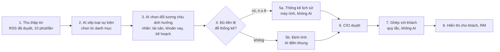

# BRD — Xử lý và hiển thị tin tác động đến tài sản: bằng chứng thay cho dự báo

| | |
|---|---|
| Ngày | 28/10/2026 |
| Trạng thái | **Đề xuất**, chưa triển khai (trừ mục 8.1 đã làm ngày 27/10) |
| Người yêu cầu | Chủ sản phẩm, trong phiên làm việc 27–28/10/2026 ([nguồn](brd/sources/owner_requests/2026-10-28_news_evidence.md)) |
| Mã yêu cầu | OWN-NE-01 … OWN-NE-15 ([owner_requirements](brd/requirements/owner_requirements.md#ne--news-as-evidence-not-forecast-2026-10-28)) |
| Liên quan | FEAT-25 (cảnh báo chính sách), FEAT-01 (thu thập tin), FEAT-04 (agent nhận định), goal branch (`src/procedural`), tài liệu *Luồng end-to-end mới – Wealth Platform sau thay đổi* (28/10/2026) |

## 1. Bối cảnh và vấn đề

Hiện nay nhiều phần đánh giá tác động cố gắng **lượng hóa bằng dự báo**: kịch bản P5–P90 cho từng sự kiện, nghiêng
danh mục theo Black–Litterman, "khả năng đạt mục tiêu", con số VND cho từng tin. Thị trường chịu tác động của cả yếu
tố hợp lý lẫn yếu tố hành vi, nên các con số này **không kiểm chứng được**: đầu vào là phỏng đoán, đầu ra trông chính
xác. Với khách private banking, một con số sai làm mất niềm tin vào cả hệ thống; với Tuân thủ, một con số không truy
được căn cứ là rủi ro.

Tài liệu *Luồng end-to-end mới* đã viết "Hệ thống không dự báo giá", nhưng vẫn giữ P5–P90 và Black–Litterman. BRD
này đưa nguyên tắc đó vào toàn bộ phần tin tức.

## 2. Nguyên tắc

| # | Nguyên tắc |
|---|---|
| N1 | **Chỉ lượng hóa những gì tính được từ dữ liệu đã biết**: lãi vay theo hợp đồng, thuế theo quy định, lệch danh mục, thiếu thanh khoản, LTV theo từng mốc giá. |
| N2 | Tác động của một tin lên giá được thể hiện bằng **chiều hướng · thời gian · bằng chứng**, không bằng một con số dự báo. |
| N3 | Bằng chứng là **thống kê lịch sử** khi đủ mẫu; không đủ thì là **định tính**: kênh truyền dẫn, ảnh hưởng lên tài sản, tiền lệ. |
| N4 | AI đọc tin và chọn nhãn từ danh mục cố định. **AI không thấy dữ liệu khách**; việc ghép tin với khách do quy tắc làm. |
| N5 | Khi có thống kê, **chiều hướng lấy từ thống kê**, không từ phỏng đoán của AI. |
| N6 | Mọi nhận định đến khách hoặc RM phải qua **CIO duyệt**; mỗi bước có nhật ký. |

## 3. Phạm vi

**Trong phạm vi:** luồng xử lý tin từ thu thập đến hiển thị; hai nhánh bằng chứng (thống kê, định tính); ghép tin với
khách qua tài sản đang giữ, khoản vay và kế hoạch (mục tiêu); hiển thị trên chart "Tác động lên tài sản ròng", thẻ tin,
danh sách tin ở Tổng quan; màn CIO duyệt.

**Ngoài phạm vi:** dự báo giá; khuyến nghị mua/bán mã cụ thể; dữ liệu AML, PEP, xếp hạng rủi ro (BRD §13.2, FR-604);
tự động gửi nội dung cho khách.

## 4. Luồng xử lý

| Bước | Làm gì | Ai / cái gì | Đầu ra | Dùng AI |
|---|---|---|---|---|
| 1 | Lấy tin từ nguồn đã duyệt, lọc trùng, kiểm tra thời gian, danh sách hạn chế | Job `news_ingest` (đã có) | Tin trong hộp tin | Không |
| 2 | Xếp tin vào **một loại sự kiện** trong danh mục (vd. "Fed giảm lãi suất", "NHNN tăng lãi suất điều hành", "Chính sách vàng miếng") hoặc "Loại mới" | Agent | Mã loại sự kiện | Có |
| 3 | Chọn **đối tượng chịu ảnh hưởng** từ danh mục nhãn (mục 7) | Agent | Danh sách nhãn | Có |
| 4 | Đếm số tiền lệ của loại sự kiện trong lịch sự kiện | Máy | n | Không |
| 5a | Tính thống kê (mục 5) | Máy | Thống kê + chiều hướng | Không |
| 5b | Điền khung định tính (mục 6) | Agent | Khung định tính | Có |
| 6 | Duyệt, sửa, trả lại hoặc từ chối | CIO | Nhận định đã duyệt | Không |
| 7 | Tìm khách có nhãn khớp (mục 7) | Máy | Danh sách khách bị ảnh hưởng | Không |
| 8 | Hiển thị theo vai trò (mục 8) | Giao diện | Chart, thẻ tin, feed | Không |

Loại sự kiện "Loại mới" luôn đi nhánh định tính. CIO có thể thêm loại mới vào danh mục kèm lịch tiền lệ.

## 5. Nhánh thống kê

**Điều kiện:** loại sự kiện có **ít nhất 8 tiền lệ** trong lịch sự kiện (cấu hình được) và có chuỗi giá lịch sử của tài
sản liên quan.

**Chỉ số bắt buộc** (cho mỗi cặp loại sự kiện × loại tài sản × khung thời gian):

| Chỉ số | Ví dụ |
|---|---|
| Số tiền lệ (n) | 12 lần |
| Số lần theo chiều | giảm 7/12 lần |
| **Mức nền**: tỷ lệ cùng chiều ở một khoảng thời gian bất kỳ cùng độ dài | 45% số tuần |
| Mức thay đổi trung vị | −1,2% |
| Dải thấp nhất – cao nhất | −6% đến +4% |
| Giai đoạn dữ liệu | 2008–2026 |

**Quy tắc chiều hướng** (N5):
- Tỷ lệ cùng chiều cao hơn mức nền **từ 10 điểm % trở lên** → Tích cực hoặc Tiêu cực theo chiều đó.
- Chênh lệch dưới 10 điểm % → **Trung tính / chưa rõ**.
- Ngưỡng 10 điểm % là đề xuất, cần CIO chốt (Q2).

**Khung thời gian:** 1 tuần · 1 tháng · 3 tháng, đo từ ngày công bố sự kiện.

**Cách viết:** luôn ghi n và mức nền. Không ghi tỷ lệ % đứng một mình.

> Trong **12 lần** Fed giảm lãi suất từ 2008, VN-Index giảm trong tuần sau đó **7 lần (58%)**, so với **45%** ở một
> tuần bình thường. Trung vị −1,2%, dao động −6% đến +4%. *(số minh họa)*

**Dữ liệu cần có:** chuỗi giá ngày của VN-Index, giá vàng SJC và thế giới, tỷ giá USD/VND, lợi suất trái phiếu chính
phủ; lịch sự kiện (ngày quyết định của Fed, NHNN…) do CIO duyệt. Repo hiện chưa có chuỗi giá thị trường dài.

## 6. Nhánh định tính

Dùng khi không đủ tiền lệ để thống kê. AI điền khung, CIO duyệt.

| Trường | Bắt buộc | Nội dung |
|---|---|---|
| Kênh truyền dẫn | Có | Một hoặc nhiều kênh trong danh sách: **lãi suất · tín dụng · tỷ giá · thuế/phí · pháp lý · cung/cầu · dòng vốn · tâm lý thị trường** |
| Cơ chế | Có | 1–2 câu: tin → kênh → tài sản |
| Tài sản / kế hoạch bị ảnh hưởng | Có | Nhãn ở mục 7 |
| Ảnh hưởng thế nào | Có | Chiều hướng (Tích cực / Tiêu cực / Chưa rõ) và **cái gì thay đổi**: giá, dòng tiền, chi phí, thanh khoản hay thủ tục |
| Thời gian | Có | 1 tuần · 1 tháng · 3 tháng · trên 3 tháng |
| Dấu hiệu cần theo dõi | Có | Điều gì sẽ xác nhận hoặc phủ nhận nhận định |
| Tiền lệ | Có, nếu có | Danh sách, theo quy tắc dưới đây; không có tiền lệ thì ghi "Chưa có tiền lệ" |

**Quy tắc tiền lệ:**
1. Ghi số tiền lệ và nói rõ khi ít: "Tiền lệ ít (2 trường hợp), nhưng đã có tiền lệ ở: …".
2. Mỗi tiền lệ **bắt buộc** có ba phần: **sự kiện** (tên, nơi, thời gian) · **kết quả đã quan sát** · **khác biệt bối
   cảnh** so với hiện tại. Thiếu kết quả thì không đưa vào.
3. Kết quả ghi số khi nguồn có số; không có thì ghi chiều hướng bằng lời. Không tự đặt ra con số.
4. **Nguồn không bắt buộc.** Có thì hiện; không có thì **bỏ hẳn dòng "Nguồn"**, không ghi "cần bổ sung".
5. Tiền lệ chưa có nguồn mang dấu **"chưa có nguồn"**, **chỉ CIO thấy** trên màn duyệt; khách và RM không thấy. CIO duyệt
   tiền lệ chưa có nguồn được ghi nhật ký.
6. Các tiền lệ cho kết quả ngược chiều nhau đều phải ghi, không chọn lọc.

## 7. Ghép tin với khách

**Danh mục nhãn đối tượng chịu ảnh hưởng** (AI chỉ được chọn trong danh mục):

| Nhóm | Nhãn | Lấy từ dữ liệu khách |
|---|---|---|
| Tài sản đang giữ | loại tài sản (cổ phiếu, trái phiếu, vàng, tiền gửi, BĐS, cổ phần DN…), ngành, mã, khu vực BĐS | Danh mục hợp nhất (`consolidate_flow`) |
| Khoản vay | vay lãi thả nổi, vay ngoại tệ | Khoản nợ |
| Kế hoạch | chuyển tiền ra nước ngoài theo mục đích: du học, định cư, đầu tư, mua BĐS, chu cấp | Mục tiêu có dòng tiền ra (goal branch) |
| Thu nhập | lương, cổ tức, tiền thuê | Hồ sơ thu nhập |

**Nhãn của khách** được xác định **một lần khi nhập dữ liệu**, không phải mỗi lần có tin:
- Tài sản, khoản vay: có sẵn trong dữ liệu có cấu trúc.
- Kế hoạch: RM khai báo mục đích và quốc gia (đã có: `declare_outflow`). Khi chưa khai báo, AI đọc tên mục tiêu và
  **gợi ý** nhãn; RM xác nhận. Nhãn chỉ do suy đoán thì chỉ tạo việc cho RM ("xác nhận mục tiêu"), không gửi khách
  (quy tắc đã có trong goal branch).

**Ghép:** khách được coi là bị ảnh hưởng khi có ít nhất một nhãn trùng với nhãn của nhận định. Không dùng AI ở bước
này; kết quả lặp lại được và kiểm thử được.

**Thông điệp cho khách** không được chứa cụm từ cấm của Tuân thủ (FR-604: "rửa tiền", "giao dịch đáng ngờ", "PEP"…),
kể cả khi tin gốc nói về các chủ đề đó.

## 8. Hiển thị

### 8.1 Quy tắc đã triển khai (27/10/2026, FEAT-25)

- Mỗi dòng trên chart "Tác động lên tài sản ròng" ghi **mức (Cao / Trung bình / Thấp) · thời gian** thay cho VND.
- Tin chỉ chạm **vàng, trái phiếu** hoặc **tỷ giá/ngoại tệ** ghi **số tiền · thời gian** (vd. "−81 triệu · 1 tuần").
- Tin chỉ chạm **cổ phần doanh nghiệp** ghi **Tích cực / Tiêu cực**.
- Bộ lọc thời gian: 1 tuần / 1 tháng / 2 tháng / 3 tháng.

### 8.2 Bổ sung theo BRD này

Mỗi dòng ghi **chiều hướng · thời gian · nhãn bằng chứng**:

| Loại bằng chứng | Hiển thị trên dòng | Bấm vào mở |
|---|---|---|
| Thống kê | **Tiêu cực · 1 tuần · 7/12 lần** | Đủ chỉ số mục 5, giai đoạn dữ liệu |
| Định tính có tiền lệ | **Tiêu cực · 1–3 tháng · 2 tiền lệ** | Khung mục 6 và danh sách tiền lệ |
| Định tính không có tiền lệ | **Tiêu cực · 1–3 tháng · qua pháp lý** | Khung mục 6, ghi "Chưa có tiền lệ" |
| Con số chắc chắn (N1) | **−5 triệu/tháng · từ kỳ điều chỉnh lãi tới** | Cách tính (hợp đồng, quy định) |

Các quy tắc ở 8.1 về vàng, trái phiếu, ngoại tệ và cổ phần doanh nghiệp giữ nguyên.

**Theo vai trò:**

| Vai trò | Thấy |
|---|---|
| Khách | Tin đã duyệt khớp với mình; chiều hướng, thời gian, bằng chứng; không thấy dấu "chưa có nguồn" |
| RM | Như khách, cho các gia đình mình phụ trách; thêm việc "xác nhận mục tiêu" khi nhãn kế hoạch chỉ do suy đoán |
| CIO | Toàn bộ nhận định chờ duyệt, nhánh bằng chứng, dấu "chưa có nguồn", lịch tiền lệ |

## 9. Quy tắc kiểm tra khi agent nộp nhận định

Nhận định bị trả lại cho agent (tối đa 2 lần, như quy trình hiện tại) khi:

1. Loại sự kiện hoặc nhãn đối tượng không có trong danh mục.
2. Nhánh định tính thiếu một trường bắt buộc ở mục 6.
3. Kênh truyền dẫn ngoài danh sách.
4. Tiền lệ thiếu sự kiện, kết quả hoặc khác biệt bối cảnh.
5. Có con số dự báo giá (vd. "sẽ tăng 15%") ngoài nhánh thống kê.
6. Thông điệp cho khách chứa cụm từ cấm (FR-604) hoặc lời khuyên mua/bán (danh sách cụm từ cấm hiện có).
7. Nhánh thống kê: AI ghi chiều hướng khác với chiều hướng máy tính ra (N5); máy giữ chiều hướng của thống kê và ghi
   chú cho CIO.

## 10. Ví dụ

*Ví dụ minh họa. Số liệu và tiền lệ cần kiểm tra trước khi đưa vào dữ liệu thật.*

**Ví dụ 1 — Thống kê: Fed được dự báo giảm lãi suất**
- Loại sự kiện: Fed giảm lãi suất. Nhãn: cổ phiếu.
- Đủ tiền lệ → nhánh thống kê. Hiển thị: **Tiêu cực · 1 tuần · 7/12 lần**.
- Mở ra: "Trong 12 lần … so với 45% ở một tuần bình thường…" (mục 5).
- Khách khớp: mọi khách có cổ phiếu.

**Ví dụ 2 — Định tính có tiền lệ: Chính sách quản lý vàng miếng**
- Kênh: pháp lý → cung/cầu.
- Cơ chế: Nhà nước tăng cung vàng miếng, chênh lệch giá trong nước và thế giới có xu hướng thu hẹp.
- Ảnh hưởng: vàng miếng SJC, **tiêu cực về giá** (phần cao hơn giá thế giới có thể mất dần).
- Thời gian: 1–3 tháng. Theo dõi: chênh lệch SJC so với giá thế giới hằng tuần.
- Tiền lệ ít (2 trường hợp), nhưng đã có tiền lệ ở:
  - **NHNN bán vàng miếng bình ổn qua 4 ngân hàng quốc doanh (06/2024)**: chênh lệch thu hẹp mạnh trong vài tuần.
    *Khác biệt:* NHNN trực tiếp bán ra, lần này là sửa nghị định.
  - **Nghị định 24/2012**: chênh lệch nới rộng trong nhiều năm sau đó. *Khác biệt:* chính sách theo hướng siết cung.
- Hiển thị: **Tiêu cực · 1–3 tháng · 2 tiền lệ** (hai tiền lệ ngược chiều, cả hai đều được ghi).

**Ví dụ 3 — Định tính có tiền lệ: Metro số 1 vận hành**
- Kênh: cung/cầu. Ảnh hưởng: căn hộ gần ga, **tích cực về giá thuê trước, giá bán sau**; dễ bán hơn.
- Thời gian: trên 3 tháng. Theo dõi: giá thuê và lượng giao dịch quanh các ga.
- Tiền lệ ít, nhưng đã có tiền lệ ở:
  - **Tuyến Cát Linh – Hà Đông (Hà Nội, 11/2021)**: mặt bằng giá căn hộ quanh các ga tăng sau khi tuyến chạy.
    *Khác biệt:* tuyến trên cao, đi qua khu đã đông dân.
  - **Bangkok, BTS (1999) và MRT (2004)**: căn hộ gần ga (khoảng 500 m) có giá bán và giá thuê cao hơn rõ rệt so
    với khu xa ga; dự án mới dồn về dọc tuyến. *Khác biệt:* thu nhập, mật độ dân và luật sở hữu nhà khác Việt Nam,
    chỉ tham khảo chiều hướng.

**Ví dụ 4 — Định tính, không ảnh hưởng giá: tin về rửa tiền ra nước ngoài**
- Kênh: pháp lý. Cơ chế: có thể dẫn đến thắt chặt thủ tục chuyển tiền ra nước ngoài.
- Nhãn: kế hoạch chuyển tiền ra nước ngoài (du học, định cư, chu cấp).
- Ảnh hưởng: không ảnh hưởng giá tài sản; **thủ tục chuyển tiền có thể lâu hơn, cần nhiều giấy tờ hơn**.
- Thời gian: 1–3 tháng. Theo dõi: dự thảo thông tư của NHNN về ngoại hối.
- Khách khớp: khách có mục tiêu "Du học Úc cho con, 09/2027" → RM nhận việc; thông điệp cho khách: "Việc chuyển tiền
  du học cho con có thể cần thêm thời gian và giấy tờ; nên chuẩn bị trước tháng 06/2027." Không dùng từ "rửa tiền".

## 11. Ảnh hưởng tới tài liệu "Luồng end-to-end mới"

| Mục trong tài liệu | Hiện tại | Đề xuất |
|---|---|---|
| §5 Nghiêng chiến thuật | Black–Litterman (P1); dự phòng CIO nhập tay | Lấy **CIO chọn Tăng tỷ trọng / Trung lập / Giảm tỷ trọng** cho từng loại tài sản, quy đổi theo bảng cố định (vd. ±2 hoặc ±5 điểm %) làm phương án chính; Black–Litterman chuyển sang P2 |
| §5 Danh mục mục tiêu | "Khả năng đạt mục tiêu trước và sau cân chỉnh" | **Lợi nhuận cần thiết mỗi năm** để đạt mục tiêu (N1) |
| §6 Tác động của nhận định | Kịch bản P5–P90, mức Đỏ/Vàng theo P10 ba tháng | Chiều hướng · thời gian · bằng chứng (BRD này); mức Đỏ/Vàng dựa trên con số chắc chắn: lệch mục tiêu, thiếu thanh khoản, LTV vượt ngưỡng ở các mốc giảm giá |
| §6 Bất động sản | Đã tách chắc chắn / dải lịch sử | Giữ nguyên; dải lịch sử theo quy tắc tiền lệ mục 6 |
| §4 Agent | 4 nhóm phân tích, phản biện | Thêm danh mục loại sự kiện, nhãn đối tượng, khung định tính, quy tắc kiểm tra mục 9 |

## 12. Thay đổi hệ thống (dự kiến)

| Phần | File | Thay đổi |
|---|---|---|
| Danh mục loại sự kiện, nhãn, kênh | `src/views/schema.py`, `src/views/catalogue.py` | Thêm danh mục và quy tắc kiểm tra mục 9 |
| Agent | `src/views/prompts.py`, `src/views/agents.py` | Xếp loại, chọn nhãn, điền khung định tính; bản rule/mock khi tắt AI (`MF_AI`) |
| Lịch sự kiện và chuỗi giá | `data/` (sinh từ `scripts/`), `src/market/` | Lịch tiền lệ, chuỗi giá lịch sử |
| Thống kê | feature mới (vd. `src/evidence/`) | Đếm, mức nền, trung vị, dải; quy tắc chiều hướng |
| Ghép với khách | `src/procedural/goals.py`, `src/impact/ops.py` | Mở rộng ghép theo danh mục nhãn |
| Duyệt | `src/views/decide.py`, màn CIO | Duyệt khung định tính, tiền lệ, dấu "chưa có nguồn" |
| Hiển thị | `web/pages/policy.js`, `web/pages/detail.js`, `web/workspace/feed.js` | Định dạng mục 8.2 |
| Đăng ký | `app/main.py` | Nối bước mới vào luồng |
| Kiểm thử, tài liệu | `tests/`, `docs/brd/` | Kiểm thử với model giả; FEAT mới, bảng truy vết |

## 13. Tiêu chí chấp nhận

1. Không dòng nào trên chart, thẻ tin, feed hiển thị con số dự báo giá ngoài nhánh thống kê; mọi con số khác truy được
   về dữ liệu đã biết (N1).
2. Nhánh thống kê luôn hiển thị n và mức nền; n dưới ngưỡng thì đi nhánh định tính.
3. Khi có thống kê, chiều hướng hiển thị trùng với chiều hướng máy tính ra.
4. Mọi nhận định định tính có đủ trường bắt buộc; mọi tiền lệ có sự kiện, kết quả, khác biệt.
5. Tiền lệ không có nguồn không hiện chữ "Nguồn"; dấu "chưa có nguồn" chỉ xuất hiện với CIO.
6. Agent không nhận dữ liệu khách nào (kiểm tra đầu vào của agent).
7. Ghép tin với khách cho cùng kết quả qua các lần chạy.
8. Thông điệp cho khách không chứa cụm từ cấm FR-604.
9. Ví dụ 4 chạy được từ đầu đến cuối trên dữ liệu mẫu: tin → nhãn kế hoạch → khách có mục tiêu du học → việc cho RM.

## 14. Câu hỏi mở

| # | Câu hỏi | Ai chốt |
|---|---|---|
| Q1 | Ngưỡng tối thiểu để thống kê: 8 tiền lệ có phù hợp? | CIO |
| Q2 | Ngưỡng chênh lệch so với mức nền để gọi là Tích cực/Tiêu cực: 10 điểm %? | CIO |
| Q3 | Mức Cao/Trung bình/Thấp nên tính theo **phần tài sản ròng đang nắm giữ bị ảnh hưởng** (dữ liệu đã biết) thay cho tác động ước tính hiện nay (dựa trên độ nhạy giả định)? | Chủ sản phẩm, CIO |
| Q4 | Thời gian ở mục 8.1 hiện là giả định cho từng tin; sau BRD này lấy từ thống kê hoặc khung định tính? | Chủ sản phẩm |
| Q5 | Nguồn dữ liệu giá lịch sử dùng cho demo trước 31/10? | Chủ sản phẩm |
| Q6 | Khách có được thấy tiền lệ chưa có nguồn (đã được CIO duyệt) không, hay chỉ RM? | Tuân thủ |

## 15. Lộ trình

| Mức | Nội dung |
|---|---|
| P0 — trước 31/10 | Nhánh định tính cho 19 tin hiện có (kênh, cơ chế, ảnh hưởng, theo dõi, tiền lệ); hiển thị mục 8.2; ví dụ 4 chạy đủ vòng |
| P1 — nếu kịp | Nhánh thống kê cho 1–2 loại sự kiện (lãi suất Fed/NHNN → VN-Index); agent xếp loại và điền khung với tin thật |
| P2 — sau cuộc thi | Toàn bộ danh mục loại sự kiện; AI gợi ý nhãn mục tiêu; cập nhật tài liệu Luồng end-to-end theo mục 11 |
