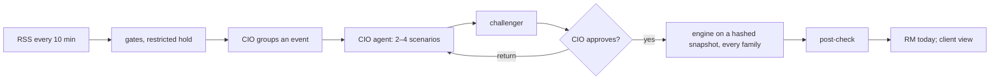

# OneWealth — product overview

OneWealth shows a Private client's whole wealth in one picture and says what is moving it. Two capability sets
live in one product:

1. **The wealth picture** (from the original brief, [SRC-02](sources/README.md)): consolidation of every source
   (FEAT-20), the dashboard (FEAT-21), statements and chat declarations (FEAT-22, 23), the risk test (FEAT-24),
   policy-cost alerts and house views (FEAT-25), life scenarios, stress tests and goals planning (FEAT-26), the RM
   approval queue (FEAT-27), and a mock advisory record (FEAT-28).
2. **The news-impact system** (the BRD, [SRC-01](sources/README.md)): “AI writes scenarios, the machine computes
   the numbers, people approve.” News is fetched and gated (FEAT-01), grouped into events (FEAT-02), analysed by
   the CIO agent (FEAT-04), challenged (FEAT-05), decided by the CIO (FEAT-06), computed for every family by a
   deterministic 15-factor engine (FEAT-07, 08), traced to its source (FEAT-09), delivered by role (FEAT-13), with
   a goal branch for regulations (FEAT-10), research release (FEAT-03), an audit chain (FEAT-11) and roles (FEAT-12).

## Users

| Role | Main work | Home screen |
|---|---|---|
| Client (demo) | sees their wealth, plans, risk test, news impact | SCR-CL-01 |
| RM | families to call first, family impact and its trace, goal tasks | SCR-RM-01 |
| CIO | inbox, events, views, approval, runs, exposure, research, model | SCR-CIO-01 |
| Compliance | held news, research release, audit log | SCR-CMP-01 |

## One event, end to end

## What is real and what is not

Real: the news (public RSS), all logic and rules, the engine, the audit chain, the tests (254 passing on
2026-10-16), and on the public demo since 2026-10-16 the AI: the CIO agent, its challenger on another vendor and
the Copilot's router run on real models. Mock or assumed: clients and prices ([ADR-0005](decisions/ADR-0005-mock-clients-and-prices-public-news.md)),
factor-model parameters ([ADR-0004](decisions/ADR-0004-assumed-factor-model-parameters.md)), the restricted list,
identities ([ADR-0006](decisions/ADR-0006-the-role-switcher-is-not-security.md)). The agents run in mock mode unless
two models are configured ([ADR-0010](decisions/ADR-0010-two-configured-models-and-a-labelled-mock.md)); the Copilot
routes by keywords unless `LLM_MODEL_COPILOT` is set ([ADR-0012](decisions/ADR-0012-the-copilot-routes-and-never-reads-client-data.md)).

## Status in one paragraph

Of the BRD's 61 requirements, most are implemented and verified by tests; the gaps are listed in the
[traceability matrix](requirements/requirements_traceability.md) — notably versioned
configuration (FR-701), the agent catalogue (FR-703), the policy agent (FR-306), the newsletter (FR-801); accuracy
tracking (BR-15) is built on real market history since F3 (FEAT-18); goal impact per run (FR-404) is built on our definition, awaiting the CIO
(Q-11, decided in ADR-0017). The redesign kit's additions are built (2026-10-16, [docs/REDESIGN_KIT_PLAN.md](../REDESIGN_KIT_PLAN.md)):
Toàn cảnh with the feed (FEAT-29, 31), the impact graph (FEAT-30) and the Copilot (FEAT-32). At the owner's request
the interface answers the Copilot: its state is shown, and an answer marks the numbers it read (FEAT-33). The whole
interface was then redrawn to the kit's concept board (UI redesign R0–R7, [docs/UI_REDESIGN_PLAN.md](../UI_REDESIGN_PLAN.md),
report in [docs/UI_REDESIGN_REPORT.md](../UI_REDESIGN_REPORT.md)): every page in one look, the pre-redesign pages
rebuilt, the overview graph, an event timeline, the CIO's run graph, Copilot 2.0, browser tests for every route.

## Roadmap (from the BRD §18)

Redrawn from BRD Figure 5 (the BRD's plan for the bank, not this repository's): core demo (10/2026, done) →
preparation (11–12/2026: content flows, TT 53 file, model calibration, AI infrastructure) → pilot (4 months, 300
clients, 20 RMs, real data, accuracy) → expansion (to month 12, 70 % of Private clients, client app, specialist
flow 3) → full (months 18–24, 88 %, new assistants, Priority clients); three control gates between them.
