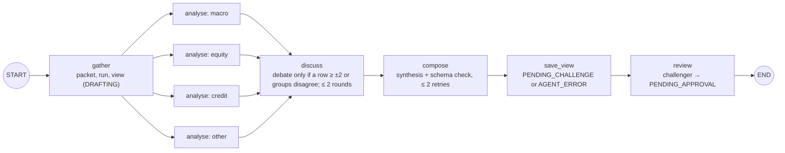

# Agent workflows

The language-model tasks of the product, what they may read, and how they are controlled. Behaviour detail:
[FEAT-04](../features/FEAT-04-cio-agent.md), [FEAT-05](../features/FEAT-05-challenger.md).

## Inventory

| Task | BRD (§8) | Here | Model resource | Reads | Modes |
|---|---|---|---|---|---|
| CIO agent | Opus, high effort; owner CIO; risk high | `cio_agent_flow` (`src/views`) | `llm:cio` (`LLM_MODEL_CIO`) | event news, released research, catalogues, factors | live · mock (keywords) |
| Challenger | Sonnet, ≠ CIO model; owner Compliance; risk medium | `review` → `agents.challenge` | `llm:challenger` (`LLM_MODEL_CHALLENGER`) | the view, the event | live · mock (rules R1–R7) |
| Policy agent | Opus, medium; owner Compliance | — | — | — | not built (FEAT-16) |
| Internal explanation | template or in-bank model | templates: post-check summary, trace formula | none | — | deterministic |
| Statement reading (pre-BRD) | — | `statement_flow` | `llm:assistant` | the uploaded file | AI on/off/auto, rule fallback |
| Chat declaration (pre-BRD) | — | `declare_flow` (operonx-agents `Agent`, 6 tools) | `llm:assistant` | the client's message | AI on/off/auto, rule fallback |
| Copilot | — (kit) | `copilot_flow` (`src/copilot`, FEAT-32) | `llm:copilot` (`LLM_MODEL_COPILOT`) | scrubbed question, route without ids, tool catalogue | keyword (default) · live (ADR-0012) |

The same inventory is served as the agent catalogue (FR-703, FEAT-15, SCR-CIO-08).

## The CIO agent graph (BRD §8.1 → `src/views/graph.py`)

Every node is recorded in the agent run. Recorded live run of 2026-10-15 (OpenRouter, Sonnet 5.5 as CIO, Haiku 5.5
as challenger): the CIO agent took 26 s over 7 recorded nodes; the challenger 13 s, 8 findings of which 3 critical.

## Controls (BRD §8.3) and where they are

| Control | Implementation | Test |
|---|---|---|
| Data wrapped as DỮ_LIỆU … HẾT_DỮ_LIỆU, told it is data | `agents.wrap` | `test_an_injection_in_the_news_stays_data` |
| Shock sizes only from the library; no figures from AI | schema: size ∈ S/M/L, factor ∈ catalogue; engine computes | `test_the_schema_refuses` |
| Schema check before saving | `src/views/schema.py::check` in `compose` and on every CIO edit | `test_the_schema_refuses`, `test_an_invalid_edit_is_refused_and_changes_nothing` |
| Two different models | `resolve_mode` refuses equal models | `test_live_mode_refuses_same_models_a_cut_reply_and_another_model` |
| No fallback model | a reply naming another model is refused | idem |
| Truncation is an error | `finish_reason == "length"` refused; per-step token caps | idem |
| Full trace per node | `_record` → node with input, prompt, prompt version, model, output, time | `test_the_mock_agent_writes_a_valid_view_and_records_every_node` |
| No client data in prompts | inputs of `gather`; prompt inspection | `test_live_mode_uses_two_models_and_no_client_data_reaches_them` |
| Models and prompts as two-person config | — | not built (FEAT-14) |
| Daily budget, cost per event | — | not built (NFR-10) |
| Fixed evaluation set on prompt/model change | `src/views/evalset.py`, `data/agent_eval.json`, job `agent_eval`; approval refused until it passed (`control/config.py::decide`) | `tests/test_config_f4.py::test_a_prompt_change_runs_the_eval_set_and_needs_a_second_admin`, `tests/test_config_f4.py::test_a_proposal_that_fails_the_eval_set_cannot_be_approved` |

## Changing a model or a prompt

Both are configuration (Admin, two people; FEAT-14): propose new `prompts` or `models` in Cấu hình. The
`agent_eval` job runs the fixed eval set on the proposal within a minute or so (six sample events through every
step, ≈ 50 model calls on the owner's key); a second Admin approves once it passed. Every node records the id of
the prompts version it used (`CF-prompts-vN`). Version 1 of the models is `LLM_MODEL_CIO` / `LLM_MODEL_CHALLENGER`
in `.env`; version 1 of the prompts is `src/views/prompts.py::DEFAULT`.
