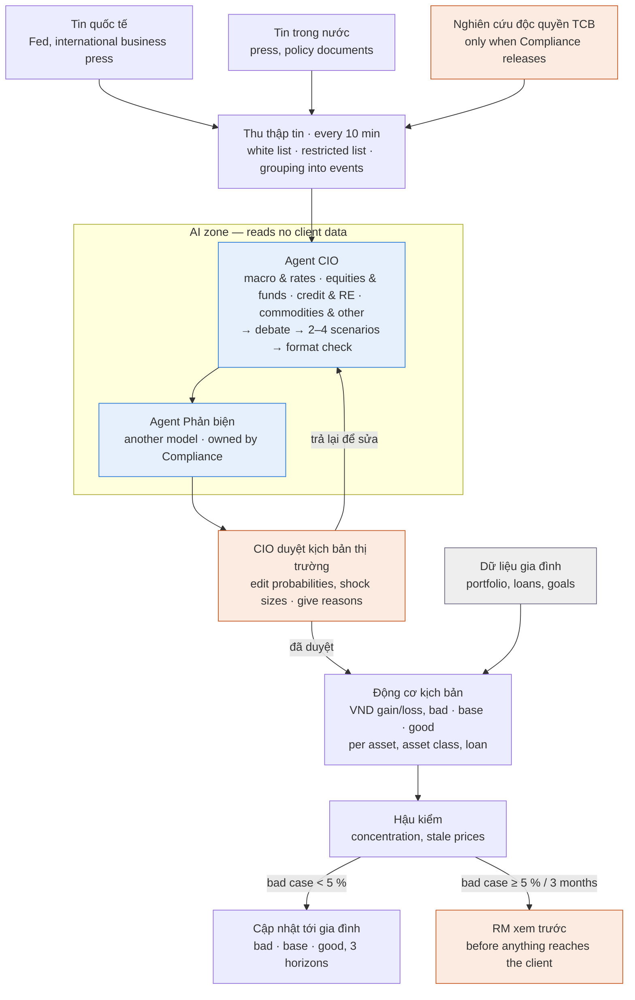
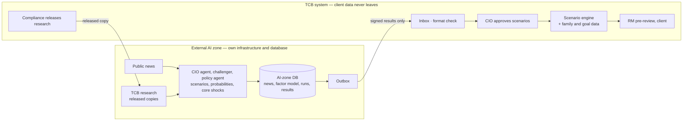
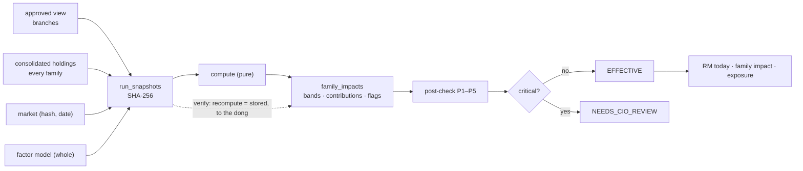

# Data flows

## 1. One event, from news to the family (BRD Figure 1)

Redrawn by us from BRD §5 (Figure 1, “AI soạn kịch bản, máy tính con số, người duyệt trước khi tới gia đình”).
Colours of the BRD's legend: blue = AI, orange = a human checkpoint, grey = client data.

Here: FEAT-01 → 02 → 04 → 05 → 06 → 07/08 → 13. The “update to the family” is an in-app page, nothing is sent.

## 2. What data each part reads (the barrier, as implemented)

| Part | Reads | Never reads |
|---|---|---|
| News ingestion (FEAT-01) | public feeds, news config | anything about clients |
| CIO agent, challenger (FEAT-04, 05) | the event's news, released research, catalogues, the 15 factors and shock library | families, holdings, goals, results, audit, restricted-list config |
| Preview (FEAT-06) | branches, factor model | families |
| Application run (FEAT-08) | approved branches, factor model, every family's consolidated holdings, market | — (no AI) |
| Goal branch (FEAT-10) | released regulation notes, goals (dated outflows, declarations) | AML data (none exists), holdings |
| Trace (FEAT-09) | a run, its snapshot, view, event, news | — (staff only) |
| Statement reading, declarations (FEAT-22, 23) | the client's file or message → the model **when AI is on** | — (pre-BRD; bank deployment must keep this in-bank) |

## 3. The two zones (BRD Figure 3)

Redrawn by us from BRD §7.1 (Figure 3). **This is the BRD's target, not what runs here**
([ADR-0009](../decisions/ADR-0009-ai-barrier-by-graph-inputs-in-one-process.md)).

## 4. Money and evidence through an application run

Every arrow that writes also appends to `audit_log` in the same transaction.
