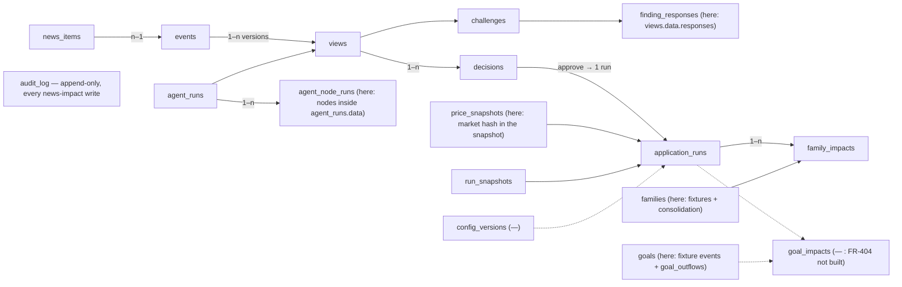
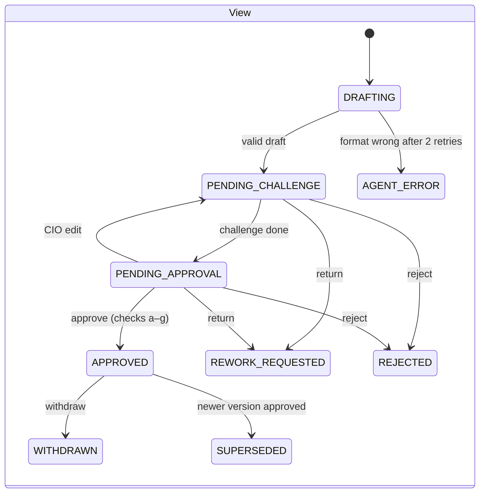
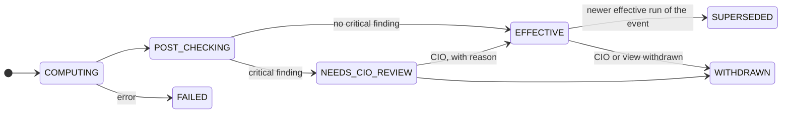

# Domain model

The entities, where they are stored, their identifiers and life cycles. Schema authority: the `SCHEMA` strings in
`src/control/db.py`, `src/control/audit.py`, `src/news/store.py`, `src/research/store.py`, `src/wealth/store.py`;
fixtures: `scripts/make_*.py`.

## 1. Read-only data (`data/`, generated, mock)

| File | Holds | Generated by |
|---|---|---|
| `clients/C01…C05.json`, `C01S.json`, `C02S.json` | 5 clients and 2 spouses: profile (income, spending, benchmark, drawdown limit), household and consent, dependents, sources (`techcombank` accounts/cards/loans/transactions, `tcbs` stocks/bonds, `techcom_capital` funds, `onehousing` properties, `open_api` other banks), `declared` assets, dated `events` (future outflows = goals of the goal branch), `behaviour` (what they did in past dips) | `scripts/make_fixtures.py` |
| `market.json` | prices, NAVs, gold, FX, area prices on 2026-10-09 (mock) | `make_fixtures.py` |
| `factors.json` | the 19 policy/macro/infrastructure factors of the pre-BRD alerts | `make_factors.py` |
| `factor_model.json` | FM-DEMO-2026-10: 15 factors, sizes, realisation, assumed covariances | `make_factor_model.py` |
| `news_config.json` | NEWS-DEMO-2026-10: sources, white list, words, event types, mock restricted list, gates | `make_news_config.py` |
| `views.json`, `advisory.json` | mock house views; mock specialists and advisory record | `make_views.py`, `make_advisory.py` |
| `samples/` | 5 statement files | `make_samples.py` |

## 2. The BRD's entity chain (BRD Figure 4)

Redrawn by us from BRD §11.4 (Figure 4), with the table each entity has **here** (or “—”).

| BRD table | Here | Notes |
|---|---|---|
| news_items | `news_items` | + `news_runs` (each fetch) |
| events | `events` | `held[]` in data |
| views | `views` | `draft`, `current`, `edits`, `responses`, `content_hash`, status history in data |
| challenges | `challenges` | `content_hash`, `independent`, findings |
| finding_responses | inside `views.data.responses` | |
| decisions | `decisions` | `idem_key` unique |
| agent_runs, agent_node_runs | `agent_runs` (nodes in data) | |
| application_runs | `application_runs` | `idem_key` unique; ranking, exposure, post-check, history in data |
| run_snapshots | `run_snapshots` | holdings, market hash and date, whole factor model, branches, SHA-256 |
| family_impacts | `family_impacts` | unique (run, family) |
| goal_impacts | — | FR-404 gap |
| research_releases (newsletter) | — | FR-801 not built |
| research (in news_items for the BRD) | `research_items` | released reports copied into `news_items` |
| goals (outflow fields) | `goal_outflows` (declarations) + fixture `events` | |
| families, instruments, price_snapshots, price_points | fixtures (`data/`) | read-only mock data |
| config_versions | — | FR-701 gap; versioned files instead |
| external_outputs | — | FR-307 inbox mode not built |
| policy_documents, policy_matches | — | FR-306 not built |
| rm_notes | — | not built (BRD §3 RM “ghi chú”) |
| users | `src/control/roles.py::USERS` | demo users, in code |
| jobs, job_steps | operonx job records | |
| counters | `counters` | |
| audit_log | `audit_log` | triggers block UPDATE/DELETE |

## 3. Pre-BRD state (`src/wealth/store.py`)

| Table | Holds |
|---|---|
| `holdings` | holdings read from statements (`statement`) and declared by chat (`declared`) per client |
| `profile` | declared dependents and income |
| `results` | the latest risk result and alerts per client (`kind`) |
| `reviews` | the RM queue: `pending` → `approved` / `rejected`, note, decided time |

None of these writes is in the audit chain (FEAT-11).

## 4. Identifiers

| Entity | Format | Example |
|---|---|---|
| News item | `NW-` + 6 digits | `NW-000390` |
| Event | `EV-<year>-` + 4 digits | `EV-2026-0001` |
| View | `VW-<event seq>-v<version>` | `VW-0001-v1` |
| Application run | `AR-<event seq>-v<version>-<n>` | `AR-0003-v1-1` |
| Snapshot | `SN-` + hash prefix + seq | `SN-4edcbe95852e0001` |
| Research item | `RS-` + 4 digits | `RS-0001` |
| Goal (goal branch) | `GL-<family>-<nn>` | `GL-C01-01` |
| Client / family | fixture id | `C01` (household of C01 + C01S) |

## 5. Life cycles

Research: `PENDING_RELEASE` → `RELEASED` | `REJECTED`. News item: `new` → `grouped` | `dismissed`; `refused` (failed a gate, kept aside); a separate `held` flag, cleared by Compliance.
RM visibility of runs: EFFECTIVE, SUPERSEDED, WITHDRAWN; client: EFFECTIVE.
