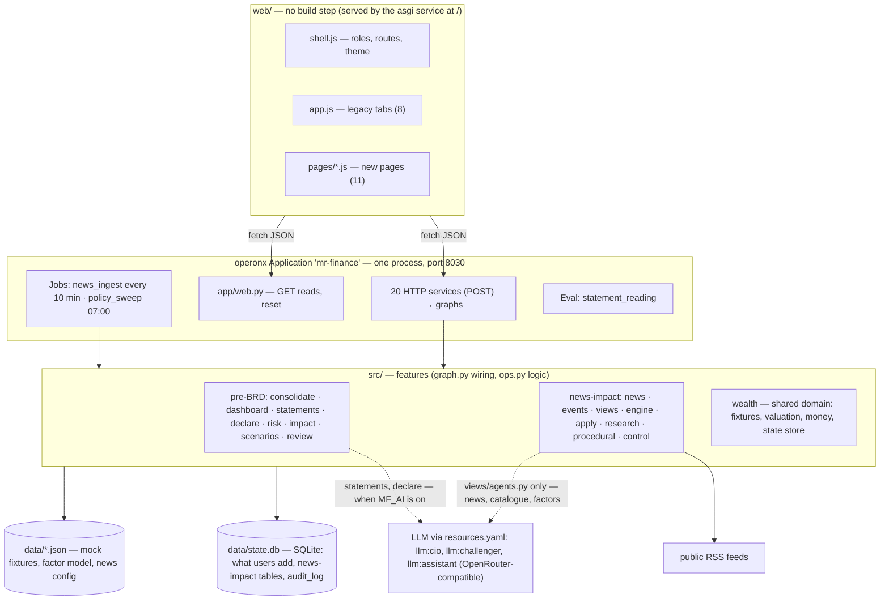
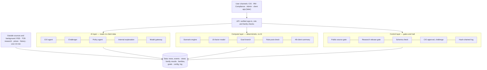

# System overview

How OneWealth is built today (2026-10-15), against the architecture the BRD describes. Code is the authority for
details: [`app/main.py`](../../../app/main.py) is the map of every service and job; [`AGENTS.md`](../../../AGENTS.md)
gives the coding rules.

## 1. The product as built

| Layer | Where | Rule |
|---|---|---|
| Presentation | `web/` | Renders what the server decided; no business decision (see §4 for the exceptions) |
| Services | `app/main.py` (20 `http` services, 1 `asgi` service, 2 jobs, 1 eval), `app/web.py` (reads) | A service runs one graph as is: JSON body → graph parameters, outputs → reply |
| Features | `src/<feature>/graph.py` (wiring only) → `ops.py` (logic) → `_helpers.py` | No feature imports another feature's graph, except `consolidate_flow` (ADR-0015 D9) |
| Domain | `src/wealth/`, `src/engine/` (pure), `src/control/` | No graphs |
| AI | `src/views/agents.py` (news-impact), `src/statements`, `src/declare` (pre-BRD) | Models by resource key only; never a client built in code |
| Data | `data/*.json` (generated by `scripts/`), `data/state.db` | Change the scripts, not the JSON |

## 2. The BRD's three layers (BRD Figure 2)

Redrawn by us from BRD §7 (Figure 2); the BRD's stack names are its author's demo, not ours.

| BRD layer element | Here | Status |
|---|---|---|
| CIO agent, challenger | `src/views` (FEAT-04, 05) | built |
| Policy agent | — | not built (FEAT-16) |
| Internal explanation | deterministic templates (post-check summary, trace formula) | built as templates |
| Model gateway | `resources.yaml` + OpenRouter-compatible endpoint | demo form |
| Scenario engine, factor model | `src/engine`, `data/factor_model.json` | built (assumed parameters) |
| Goal branch | `src/procedural` | built |
| Post-check, all-client summary | `src/apply` | built |
| Public-source gate, research gate | `src/news/rules.py`, `src/research/store.py` | built |
| Schema check | `src/views/schema.py` | built |
| CIO approval, challenge | `src/views/decide.py` | built |
| Hash-chained log | `src/control/audit.py` | built (news-impact writes only) |
| Verified sign-in | demo role switcher | out of scope for the demo (ADR-0006) |

## 3. Where the AI barrier is enforced

BRD §7.1 wants a separate AI zone. Here ([ADR-0009](../decisions/ADR-0009-ai-barrier-by-graph-inputs-in-one-process.md)):
the CIO agent's graph receives only the event's news, released research, catalogues and the factor list (`gather`);
the engine and `apply` read family data only after approval; prompts wrap data as DỮ_LIỆU … HẾT_DỮ_LIỆU; a test
inspects every prompt for client names, accounts and balances. The pre-BRD AI steps (statements, declarations)
**do** send client-provided text to the configured model when AI is on — acceptable for mock data, not for a bank
deployment (BRD NFR-08).

## 4. Logic in the presentation layer

Found during the documentation audit; small, but recorded so a refactor can move them:

| Where | What the browser computes | Risk |
|---|---|---|
| `web/pages/today.js` | Groups the server's per-run RM cases by family and **sums** their 3-month expected changes; picks the worst P10 | The family total is not computed or tested server-side |
| `web/pages/impact.js` | Sums contributions per holding across runs for the staff detail table; chooses the event shown in the fan chart (largest absolute change) | Untested aggregation |
| `web/pages/detail.js` | Maps tiers to the three source-group titles of Chi tiết | Presentation only |
| `web/pages/events.js` | Builds the `idem_key` from action, view id and content hash | The server accepts any key; idempotency depends on the client sending a stable one |

## 5. Run and deploy

`uv run operonx serve` serves everything on port 8030 (and runs the jobs on their clocks); `uv run pytest` runs the
suite; `uv run operonx studio` draws and traces the graphs. The public demo (https://oneweath.ngrok.app) serves
`main` from `/home/thanglq/mr-finance` on port 8030.
