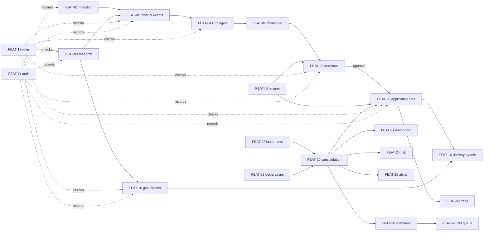

# Features (Layer B)

How each capability behaves — its inputs, rules, states, APIs, errors and tests — independent of the screen it
appears on. One file per feature; template: [`../templates/feature_template.md`](../templates/feature_template.md).

**Kinds**
- **BRD capability** — required by the BRD (Layer A ids `BRD-*`).
- **Existing capability** — built before the BRD from the original brief or PR #13 (`BRIEF-*`), kept
  ([ADR-0003](../decisions/ADR-0003-keep-the-capabilities-that-predate-the-brd.md)).
- **Proposed extension** — from the redesign kit (`KIT-*`), approved for planning, not built.

The build state below is a summary; the authoritative status per requirement is the
[traceability matrix](../requirements/requirements_traceability.md).

## The news-impact system (BRD)

| ID | Feature | Main requirements | Build state | Screens |
|---|---|---|---|---|
| [FEAT-01](FEAT-01-news-ingestion.md) | News ingestion and gates | BR-01, BR-02, BR-04, FR-101, FR-102, FR-104 | built | SCR-CIO-01, SCR-CMP-01 |
| [FEAT-02](FEAT-02-cio-inbox-and-events.md) | CIO inbox and events | FR-103, FR-104, FR-105 | built | SCR-CIO-01, SCR-CIO-02, SCR-CMP-01 |
| [FEAT-03](FEAT-03-research-and-regulation-notes.md) | Exclusive research and regulation notes | BR-03, FR-201…204 | built | SCR-CIO-06, SCR-CMP-02 |
| [FEAT-04](FEAT-04-cio-agent.md) | The CIO agent | BR-05, BR-11, FR-301, FR-302, FR-307, FR-704 | built (live queued, mock, inbox via FEAT-19) | SCR-CIO-02, SCR-CIO-03 |
| [FEAT-05](FEAT-05-challenger.md) | The independent challenger | BR-06, FR-303 | built | SCR-CIO-03 |
| [FEAT-06](FEAT-06-view-decisions.md) | CIO decisions on a view | BR-07, BR-14, FR-304, FR-305 | built | SCR-CIO-03 |
| [FEAT-07](FEAT-07-scenario-engine.md) | The scenario engine and factor model | BR-08, NFR-04, §9 | built (assumed parameters) | SCR-CIO-07 |
| [FEAT-08](FEAT-08-application-runs.md) | Application runs | BR-09, BR-13, FR-401…405, FR-501, FR-503 | built (FR-404 on our definition, Q-11) | SCR-CIO-04, SCR-CIO-05 |
| [FEAT-09](FEAT-09-number-trace.md) | “Cách tính” trace | BR-12, FR-406 | built (staff) | SCR-RM-03 |
| [FEAT-10](FEAT-10-goal-branch.md) | The goal branch | BR-10, FR-601…604 | built | SCR-RM-01, SCR-CL-05, SCR-RM-02, SCR-CIO-06 |
| [FEAT-11](FEAT-11-audit-log.md) | The audit log | BR-12, FR-702 | built, no export | SCR-CMP-03 |
| [FEAT-12](FEAT-12-roles-and-separation-of-duties.md) | Roles and separation of duties | §13.1 | demo form | shell |
| [FEAT-13](FEAT-13-impact-delivery-by-role.md) | Impact delivery by role | BR-09, FR-502, FR-503, §14 | built | SCR-RM-01, SCR-RM-02, SCR-CL-05 |
| [FEAT-14](FEAT-14-versioned-configuration.md) | Versioned configuration | FR-701 | partial | SCR-CIO-07 (read-only) |
| [FEAT-15](FEAT-15-agent-catalogue.md) | Agent catalogue | FR-703 | partial | — |
| [FEAT-16](FEAT-16-policy-agent.md) | Policy agent | FR-306 | not built | — |
| [FEAT-17](FEAT-17-cio-newsletter.md) | CIO newsletter | FR-801 | not built | — |
| [FEAT-18](FEAT-18-accuracy-tracking.md) | Accuracy over time and the measurement reports | BR-15, KPI-01/03/04, MEAS-01/02/03/05, NFR-02 | built (F3) | SCR-CIO-12, SCR-CIO-13 |
| [FEAT-19](FEAT-19-external-ai-inbox.md) | External AI zone and signed inbox | FR-307, AI-13, ZONE-01…03, ZONE-06, LC-04, SEC-07 | built | SCR-ADM-01 |

## Existing capabilities (original brief, PR #13)

| ID | Feature | Main requirements | Build state | Screens |
|---|---|---|---|---|
| [FEAT-20](FEAT-20-consolidation.md) | Consolidation | BRIEF-DATA-01…05 | built | SCR-CL-02 |
| [FEAT-21](FEAT-21-dashboard.md) | The overall dashboard | BRIEF-DASH-01…07 | built | SCR-CL-01 |
| [FEAT-22](FEAT-22-statement-reading.md) | Statement reading | BRIEF-DATA-02 | built | SCR-CL-02 |
| [FEAT-23](FEAT-23-chat-declaration.md) | Chat declarations | BRIEF-DATA-03 | built | SCR-CL-02 |
| [FEAT-24](FEAT-24-risk-test.md) | Risk-appetite test | BRIEF-RISK-01…05 | built (no re-ask) | SCR-CL-04 |
| [FEAT-25](FEAT-25-policy-cost-alerts-and-house-views.md) | Policy-cost alerts and house views | BRIEF-IMPACT-*, BRIEF-ALERT-* | built | SCR-CL-06, SCR-CL-01 |
| [FEAT-26](FEAT-26-life-scenarios-stress-tests-and-goals.md) | Life scenarios, stress tests, goals planning | BRIEF-SCEN-01…03 | built | SCR-CL-03 |
| [FEAT-27](FEAT-27-rm-approval-queue.md) | RM approval queue | BRIEF-SCEN-03, BRIEF-FLOW-02 | built | SCR-CL-03, SCR-CL-07 |
| [FEAT-28](FEAT-28-advisory-team-and-track-record.md) | Specialist team and advisory track record (mock) | — | built (mock data) | SCR-CL-07, SCR-RM-04, SCR-RM-05 |

## Proposed extensions (redesign kit)

| ID | Feature | Requirements | Plan phase |
|---|---|---|---|
| [FEAT-29](FEAT-29-financial-pulse-wealth-map-money-flow.md) | Financial Pulse, Wealth Map, Money Flow | KIT-UX-01…03 | K2 — built 2026-10-16 |
| [FEAT-30](FEAT-30-financial-intelligence-graph.md) | Financial Intelligence Graph (+ overview, News Impact panel, timeline, CIO run graph) | KIT-UX-04, OWN-UI-04 | K3, R4 — built 2026-10-16 |
| [FEAT-31](FEAT-31-intelligence-feed.md) | Intelligence Feed | KIT-UX-05 | K4 — built 2026-10-16 |
| [FEAT-32](FEAT-32-copilot.md) | OneWealth Copilot | KIT-COPILOT-01…06 | K5 — built 2026-10-16 |
| [FEAT-34](FEAT-34-header-search-and-notifications.md) | Header search and notifications | OWN-UI-03 | R1 — built 2026-10-16 |
| [FEAT-35](FEAT-35-market-data-layer.md) | Market data layer | ENG-11, BR-15, MEAS-01/02, KPI-03/04 (enabler) | F1 — built 2026-10-16 |
| [FEAT-33](FEAT-33-living-interface.md) | Living Interface (states, evidence highlight, motion rules) | OWN-MOTION-01…07, KIT-UX-06 | B-01 — built 2026-10-16 |

## How features depend on each other

