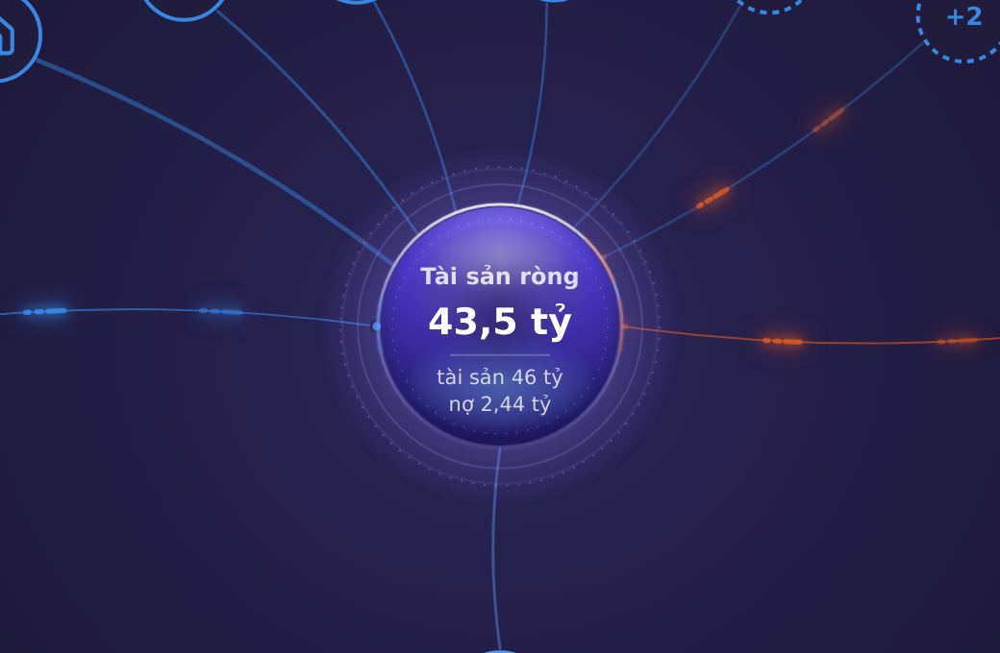
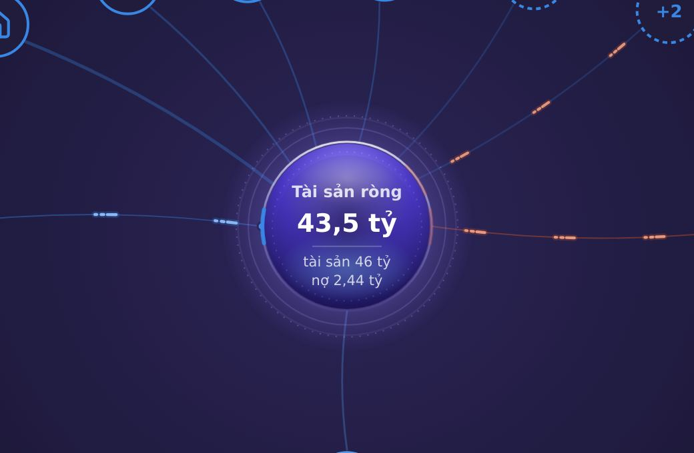
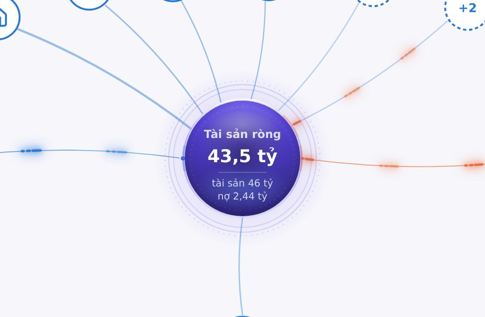
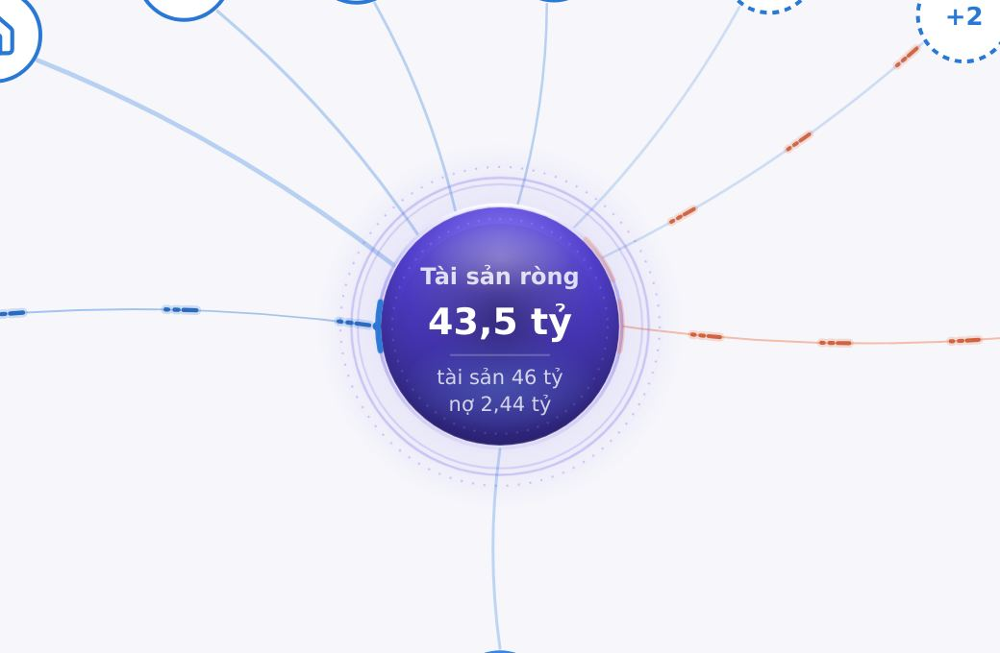
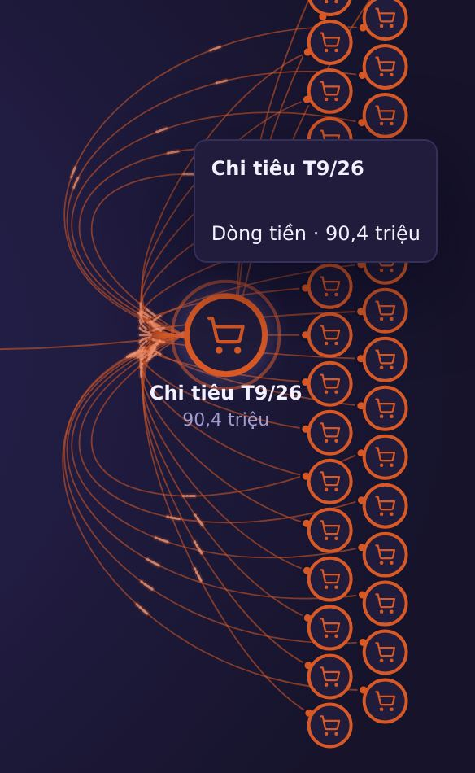
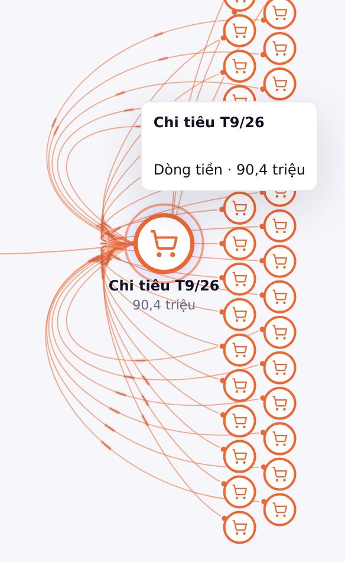
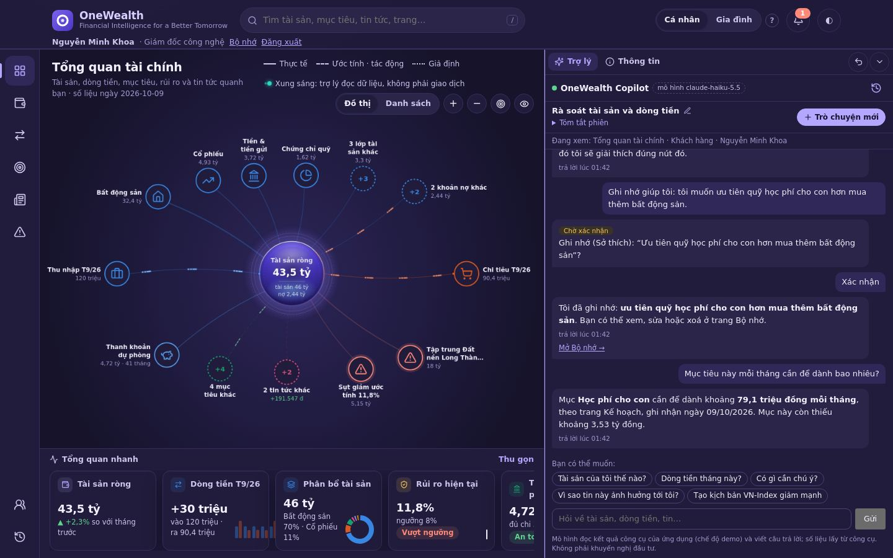
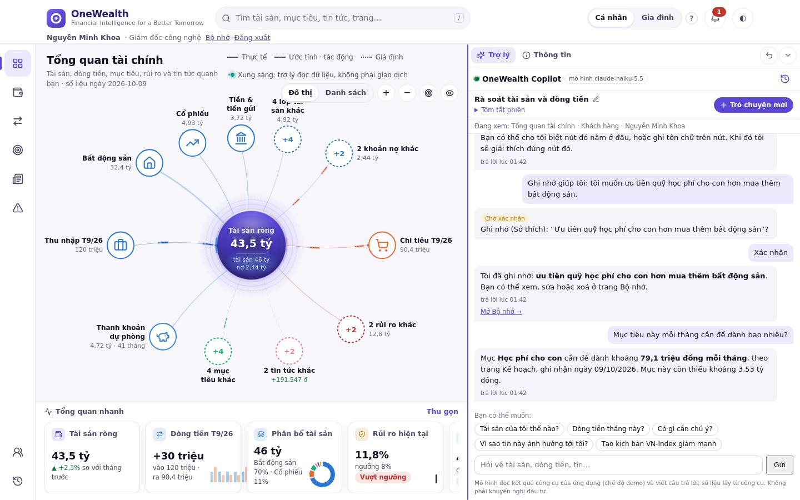
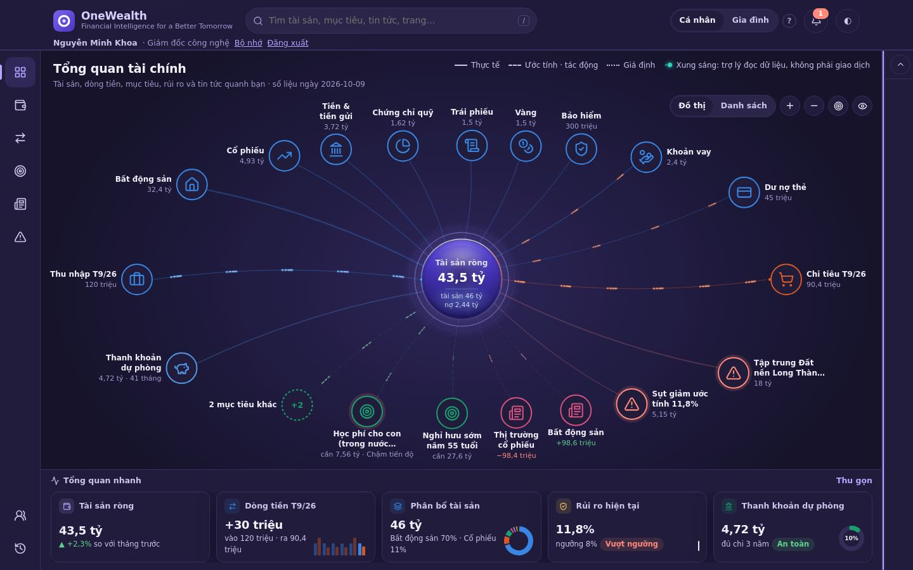
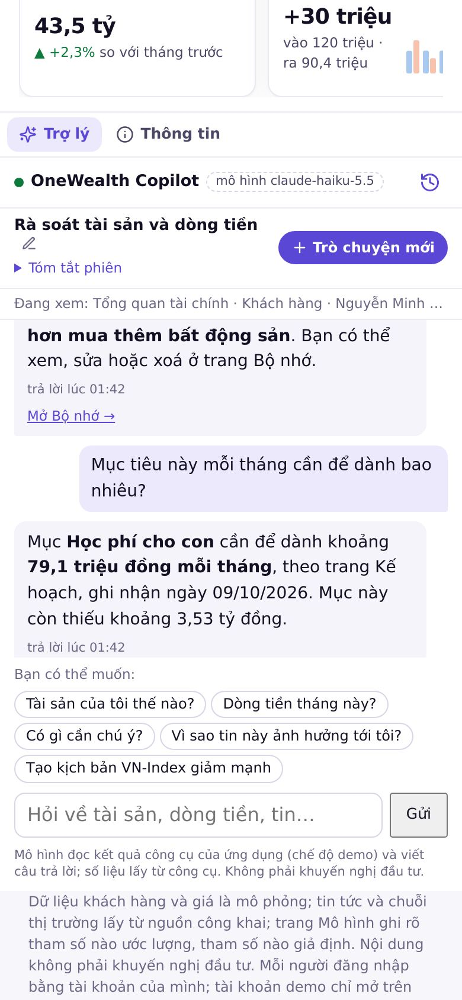

# Assistant panel and energy flows: measured tuning (2026-10-18)

The owner asked for four refinements to the customer workspace (experiment, branch `ui/panel-and-flows` from
`exp/graph-workspace`):

1. A resizable Assistant panel.
2. Lighter chat typography.
3. No regression in streaming, history, compaction, tools or the graph.
4. Quieter edges with energy flows that stand off them.

They also asked that each change be measured, not just added. This page records what was measured before and after,
what changed because of it, and how to measure it again.

**How it was measured.**
- **Machine.** Headless Chromium with software raster (no GPU), so every repaint costs CPU. This is the worst case,
  not a phone's GPU. The window is 1440×900, the client is C01, and the theme is dark unless stated.
- **CPU.** CPU time of every Chromium process (from `/proc`) while the graph runs for 6 s, as the median of three
  runs. This is `scripts/perf_flows.py`.
- **Drag.** Frame intervals and long tasks while the divider is dragged out and back, three times. This is
  `scripts/perf_dock_drag.py`.
- **Dense graphs.**
  - *Dense 3×:* the layout audit's 3× graph (`tests/ui/test_graph_layout_ui.py`).
  - *30 extra flows:* 30 spending categories added under Chi tiêu, from 0.3% to 30% of the month, giving 34 money
    edges and more than 50 sparks.

## 1. Energy flows and edges

### What the cost was

On Tổng quan, Chrome used **3.80 CPU cores** while the flows ran. With reduced motion it used 0.09. Switching parts
off one at a time showed where the cost went:

| Switched off | CPU (cores) | Share of the cost |
|---|---|---|
| Nothing | 3.80 | — |
| The sparks' two drop-shadow filters | 1.47 | 61% |
| The flicker | 2.56 | 33% (it re-filters each frame) |
| All sparks | 0.72 | 81% |
| The core's own animations | 3.35 | 12% |

Sparks with no filter and no flicker still cost 1.20 cores for 11 paths, because every moving dash repainted the
edges, nodes and labels beneath it. Moving them to a layer of their own lowered that to 0.71.

### What changed

- **Static edges.** They are quieter:
  - stroke opacity .45 → .30;
  - money edges .62 → .40;
  - summary edges .30 → .20;
  - a picked flow's edges .95 → .55 (30 overlapping ones buried their own sparks).
- **A spark.** It is a core of its edge's own hue, so it stands off the line and the colours keep their meaning
  (in, out, estimate, hypothesis, risk):
  - dark mode lightens it (60% hue);
  - light mode deepens it (88% hue; more would make the orange "out" colour look like the risk red).
- **The glow.** Only an actual transfer has a glow: a wider, faint stroke of the same hue under the core. It is not
  a CSS filter. An estimate stays dashed and unlit; a hypothesis stays as dots.
- **No flicker.**
- **Scaling by the monthly amount.** Intensity i = √(monthly ÷ the month's larger flow), between 0.12 and 1, sets:

  | Property | Range |
  |---|---|
  | Core width | 1.4 to 2.2 px |
  | Trail | 5 to 16 px |
  | Speed | 130 to 260 px/s |
  | Beads per beat | 1 to 3 |
  | Opacity | 0.6 to 1 (raised from 0.4, so the smallest flow still reads) |
- **Its own layer.** Sparks sit on an SVG layer over the graph, with the same viewBox and pan/zoom and no pointer
  events, so a moving dash repaints only that layer.
- **Reduced motion.** It hides the layer, as before. The knob where money lands stays, and so does each edge's line
  style (solid, dashed, dotted).

### Result

| View | Before (cores) | After (cores) | Frames before → after |
|---|---|---|---|
| Tổng quan | 3.80 | 1.20 | 16.7 ms → 16.7 ms |
| Tổng quan, dense 3× | 3.33 | 1.21 | 16.7 ms → 16.7 ms |
| Dòng tiền | 3.57 | 1.13 | 16.7 ms → 16.7 ms |
| Tin & sự kiện | 2.31 | 1.22 | 16.7 ms → 16.7 ms |
| Tin & sự kiện, dense 3× | 2.41 | 1.33 | 16.7 ms → 16.7 ms |
| Dòng tiền, 30 extra flows opened | 4.46 | 2.03 | **100 ms (10 fps) → 16.7 ms** |
| Reduced motion | 0.09 | 0.09 | 16.7 ms → 16.7 ms |

The layout audit (overlaps, crossings, edges through nodes or labels) stays at 0 on every lens.

 

 

The dense case after the change, with the spending flow picked and 30 flows from 0.3% to 30% of the month:

 

## 2. The resizable panel

### What changed

- **The divider.** A 10 px grip over the dock's left border (`role="separator"`) drags the dock.
  - It goes from 300 px up to 720 px, and never leaves the graph less than 420 px.
  - Dragging below 220 px folds the dock (the existing fold); dragging a folded dock opens it.
  - The arrow keys move it 16 px, Shift+arrow 64 px, and Home and End go to the ends. Enter folds or opens it.
  - A double-click or the ↺ button (shown only when the width is custom) returns to the screen's default (384 px,
    or 330 px at 1180 px and below).
  - The width is kept per browser (`mf.ws.dockw`), like the fold. A narrower window clamps what shows but keeps the
    width asked for.
- **Phones.** On a phone the dock sits below the graph and there is no divider.

### What the drag cost

| Drag on the dense 3× graph, 26-turn conversation open | Mean frame | p95 | Long tasks |
|---|---|---|---|
| A naive live resize (the graph lays out every frame) | 167 ms | 217 ms | 360 |
| The graph's layout held until release | 78 ms | 200 ms | 361 |
| Also, the width variables registered as not inherited | 36 ms | 67 ms | 338 |
| Also, the conversation frozen while the pointer moves | **29 ms** | **33 ms** | **2** |
| The harness floor (no graph, no conversation) | 20–28 ms | 33 ms | 1 |

Three causes were found and removed:

1. **The graph laid out again on every resize event.** The graph now holds while the divider drags and lays out
   once on release; meanwhile the picture is scaled on the compositor.
2. **The width was an inherited custom property on the workspace.** Every change restyled the thousands of graph
   nodes under it. `--dock-w` and `--dock-pick` are now registered as not inherited (`@property`).
3. **A long conversation reflowed every frame.** It now keeps its width while the pointer moves and reflows once
   the pointer rests (120 ms) or on release. The dock's edge and the divider still follow the pointer every frame.

 

## 3. Chat typography

### What changed

- **Answers.** 13 px at line height 1.55 (was 14 px at 1.45). Emphasis is weight 600 (was 700). Figures are tabular.
- **The parts around the answer.** Time, sources and steps are 10.5–11.5 px, so the answer leads. A card's figures
  are 14 px at weight 650, distinct from the prose. Suggestion chips are 12 px. Citation links are 11.5 px with
  6 px above them (was 16 px).
- **The chrome.**
  - The header, session row, context line (one line, ellipsis), input and disclaimer are tighter.
  - On a phone, answers stay 14 px and the input is 16 px; a smaller input zooms the page on focus.

### Result

On the same 26-turn conversation:

| Viewport | Conversation height before | After | Characters in view before | After |
|---|---|---|---|---|
| 1440×900 | 309 px | 448 px | 314 | 461 (+47%) |
| 1180×820 | 229 px | 326 px | 215 | 331 |
| 390×844 (phone) | 181 px | 285 px | 197 | 321 |

 

 

## 4. Behaviour kept

- **Tests.**
  - Every graph, flow, core and assistant UI test passes on the branch (`tests/ui`).
  - That covers streaming (text and steps drawn as they arrive), confirm and history, the panel naming the lens,
    the graph's pick, lens and pause behaviour, and reduced motion.
- **New tests** (each fails on the old code):
  - `test_assistant_panel_ui.py`:
    - drag bounds, fold, open, persistence and reset;
    - keyboard and double-click;
    - window clamp, and no divider on a phone;
    - the reading scale.
  - `test_graph_flows_ui.py::test_a_spark_stands_off_its_edge_on_its_own_layer_without_filters`: the layer, no
    filters, the core apart from its edge, edges quieter than sparks, width by amount.
- **Updated tests.** Two tests pinned the old look and now test its intent: "a real transfer glows" (now: has a glow
  stroke), and the core's band against the flow's tone (read from the glow).

## Known limits

- **The graph's toolbar can cover a top label on narrow graphs.** Seen at a 656 px graph and on the base branch at a
  1180 px window. The toolbar (Đồ thị/Danh sách, zoom) sits over the graph's top-right, and the layout audit checks
  only the SVG. This predates this work; the divider makes narrow graphs easier to reach.
- **The numbers are from software raster.** A GPU makes all of them smaller. The comparisons hold, because before and
  after ran on the same machine and harness.
