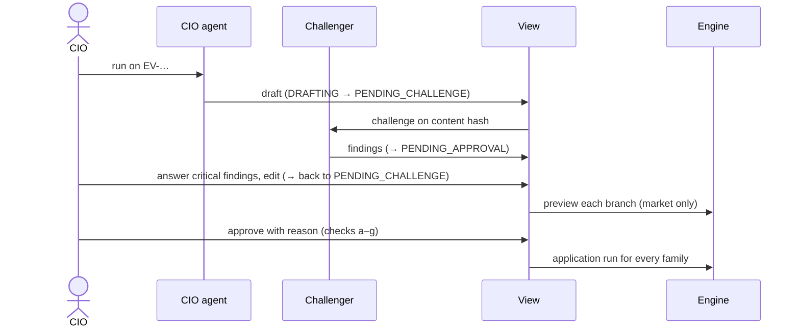

# User journeys

Layer C. The paths people take through the product, step by step, with the screen and the feature at each step.
Journeys J1–J5 are the BRD's workflow (§5); J6 is the original brief's demo (docs/DEMO.md).

## J1 — From news to an event (CIO, Compliance)

| # | Who | Does | Screen | Feature |
|---|---|---|---|---|
| 1 | Machine | Fetches every white-listed feed every 10 min, gates, sorts, holds restricted mentions | — (job) | FEAT-01 |
| 2 | Compliance | Reads a held item, releases it with a reason | SCR-CMP-01 | FEAT-02 |
| 3 | CIO | Filters the inbox, checks related items, “Gom thành sự kiện” | SCR-CIO-01 | FEAT-02 |
| 4 | CIO | Opens the event, “Chạy Agent CIO” | SCR-CIO-02 | FEAT-04 |

## J2 — From a draft view to approval (CIO)

Screens: SCR-CIO-03 throughout; the run appears on SCR-CIO-05. Alternative endings: **Trả lại** (rework → run the
agent again → v2), **Bác** (rejected), and later **Thu hồi** (withdraw: the runs are withdrawn and RMs see “Đã
thu hồi”).

## J3 — From a run to the RM's call (RM)

| # | Does | Screen | Feature |
|---|---|---|---|
| 1 | Opens “Hôm nay”: families whose 3-month P10 ≤ −5 % of net worth, worst first | SCR-RM-01 | FEAT-13 |
| 2 | Opens a family: the hero number, the band, contributions, events | SCR-RM-02 | FEAT-13 |
| 3 | “Cách tính” on an event: holdings → scenarios → approval → news → snapshot | SCR-RM-03 | FEAT-09 |
| 4 | Calls the client (outside the product) | — | — |

## J4 — Exclusive research and regulation notes (CIO, Compliance)

| # | Who | Does | Screen | Feature |
|---|---|---|---|---|
| 1 | CIO | Uploads a report or a regulation note (after its release time) | SCR-CIO-06 | FEAT-03 |
| 2 | Compliance (another person) | Releases with a ≥ 20-character note, or rejects | SCR-CMP-02 | FEAT-03 |
| 3a | — | A report enters the inbox as “Độc quyền” | SCR-CIO-01 | FEAT-01/02 |
| 3b | — | A regulation note goes to the goal branch | — | FEAT-10 |

## J5 — A regulation that delays a goal abroad (RM, client)

| # | Who | Does | Screen | Feature |
|---|---|---|---|---|
| 1 | — | The released note matches goals: inferred → “RM xác nhận mục tiêu” | SCR-RM-01 | FEAT-10 |
| 2 | RM | Confirms purpose and country with the client, declares them | SCR-RM-02 (form) | FEAT-10 |
| 3 | — | The level becomes contact now / remind / note; the milestone is set | SCR-RM-01 | FEAT-10 |
| 4 | Client | Sees the generic message on “Lưu ý cho mục tiêu của bạn” | SCR-CL-05 | FEAT-10 |

## J6 — The brief's five-minute demo (client, RM)

`docs/DEMO.md` was written before the redesign; its section names map to today's menus as follows.

| DEMO.md step | Then | Now |
|---|---|---|
| 1 Connect the data | “Kết nối dữ liệu” | Khách hàng → **Tài sản** (SCR-CL-02) |
| 2 The risk test | “Bài test rủi ro” | Khách hàng → Mục tiêu & kịch bản → **Khẩu vị rủi ro** (SCR-CL-04) |
| 3 The overall dashboard | “Tổng quan” | Khách hàng → **Tổng quan** (SCR-CL-01) |
| 4 An alert lands | “Cảnh báo” | Khách hàng → Tin tác động → **Chi phí chính sách** (SCR-CL-06) |
| 5 A scenario | “Kịch bản” | Khách hàng → Mục tiêu & kịch bản → **Kế hoạch** (SCR-CL-03), “Gửi chuyên gia duyệt” |
| 6 The RM approves | “RM duyệt” | RM → Khách hàng → **Duyệt đề xuất** (SCR-RM-06); the client follows it on Chuyên gia (SCR-CL-07) |

The demo's HTTP path is tested end to end (`tests/test_demo.py::test_the_five_minute_demo`); its click path is not.
